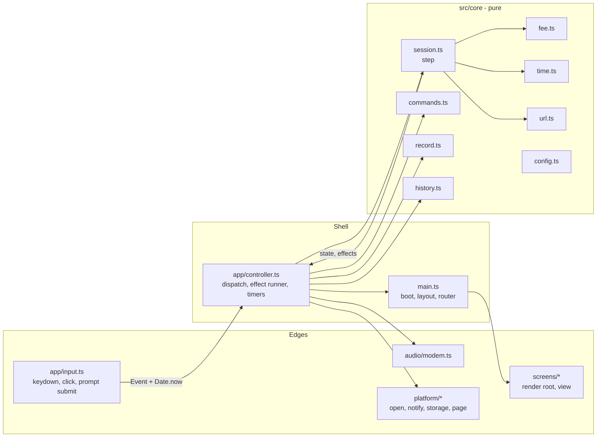

# Design Document: BLUELINE Core Flow

## Overview

BLUELINE is a static TypeScript + Vite single-page app with no UI framework. One browser tab (the BLUELINE tab) walks the user through Dial → Destination → Duration → Connect confirm → Session → NO CARRIER → Receipt.

The design has three layers:

1. **Pure core (`src/core`)**: the state machine, fee, time formatting, URL normalization, command parsing, record serialization, and history totals. Core functions take `now` as an argument, never touch the DOM or browser APIs, and return new values. The state machine returns a list of *effects* (for example "open this URL", "play the NO CARRIER sound", "append this record") instead of performing them.
2. **Shell (`src/main.ts`, `src/app/controller.ts`, `src/app/input.ts`)**: owns the single mutable `AppState`, reads the clock with `Date.now()`, turns DOM input into core events, runs the effects the core returns, and re-renders.
3. **Edges (`src/screens`, `src/audio`, `src/platform`)**: screens build DOM from state; `audio/modem.ts` synthesizes sound with Web Audio; `platform/*` wraps `window.open`, `Notification`, `localStorage`, document title, and visibility.

Because the reducer returns effects as data, requirements such as "end the session exactly once", "play the NO CARRIER sound at most once", and "write the record before showing NO CARRIER" become properties of a pure function and are tested with fast-check.

### Key design decisions

| Decision | Choice | Reason |
|---|---|---|
| State updates | Pure reducer `step(state, event) → { state, effects }` | Every transition and side effect is testable without a browser. |
| Time | Store `start` timestamp; compute `elapsed = clamp(floor((now − start)/1000), 0, planned)` on every render | Tech constraint; timer ticks only trigger renders, they never count time. |
| Time-up detection | One-shot `setTimeout` at the scheduled end, plus a 250 ms render interval, plus a check on `visibilitychange` and `pageshow` | A single unchained timeout is not subject to Chrome's intensive (1-per-minute) throttling of chained timers, so the hidden-tab bound of 60 s (Req 7.9) holds on desktop browsers. On browsers that pause background tabs (Safari on iPhone), the resume check ends the session on return (Req 7.13). |
| Two user actions to connect | Picking a duration requests notification permission and shows `CONNECT? PRESS ENTER`; Enter or the CONNECT button on that screen calls `window.open` | Chrome uses up the user activation when `window.open` succeeds, and Safari needs a user gesture for `Notification.requestPermission`. Separate gestures give each call its own activation (Req 7.4, 5.1). |
| Opening the destination | `window.open(url, '_blank')` called synchronously in the confirm key/tap handler, then `w.opener = null` | `window.open` with the `noopener` feature always returns `null`, which would hide popup blocking. Nulling the opener right after open keeps blocker detection and meets Req 5.3. `<meta name="referrer" content="no-referrer">` keeps the BLUELINE origin out of the destination's referrer. |
| Popup fallback | `<a href target="_blank" rel="noopener noreferrer">` that receives focus | A real link is never popup-blocked and is reachable by keyboard (Req 13.4). |
| Box drawing | Pure ASCII `+ - \|` characters, border characters `aria-hidden` | "ASCII box" in the requirements; avoids glyph-width issues with box-drawing characters; screen readers read only the content. |
| Font | GalmuriMono11 (SIL OFL 1.1, no Reserved Font Name), unmodified upstream `.woff2` in `public/fonts/` with `ofl.md` | Monospace pixel font with Hangul. Shipping the unmodified file avoids any OFL "Modified Version" questions. |
| Storage format | JSON with a version field, two keys: `blueline.history.v1`, `blueline.active.v1` | Simple to validate; versioned for later changes. |

## Architecture



### Dispatch loop

```ts
// app/controller.ts (shape, not final code)
function dispatch(event: Event): void {
  const { state: next, effects } = step(state, event);
  state = next;
  for (const effect of effects) runEffect(effect); // may dispatch follow-up events synchronously
  render(state, view());
}
```

`runEffect('openDestination')` runs inside the same call stack as the user's keydown or click, so `window.open` keeps the user activation. It immediately dispatches `OPENED { now }` or `POPUP_BLOCKED`.

### Session state machine

```mermaid
stateDiagram-v2
  [*] --> IDLE
  [*] --> CONNECTED: reload, valid active session, not expired
  [*] --> ENDED: reload, valid active session, expired
  IDLE --> DIALING: DIAL
  DIALING --> SELECT_DEST: SHOW_MENU (only after CONNECT shown)
  SELECT_DEST --> SELECT_DURATION: destination selected
  SELECT_DURATION --> SELECT_DEST: BACK / key 0 (from the Duration_Menu)
  SELECT_DURATION --> SELECT_DURATION: duration picked → confirm screen; BACK on confirm → Duration_Menu
  SELECT_DURATION --> CONNECTED: CONFIRM → OPENED / LINK_OPENED
  CONNECTED --> ENDED: TIME_UP / HANG_UP / TICK past end
  ENDED --> IDLE: DIAL_AGAIN (from receipt view)
```



Any event not listed for the current phase returns the same state and no effects (Req 14.4). The Connect_Confirm_Screen is a sub-view of SELECT_DURATION, so the six Session_States of Requirement 14 stay unchanged.

### Timing plan for the 1 MIN demo (Req 13.3)

| Step | Duration |
|---|---|
| `ATDT 0145550199` typed at 60 ms per character (15 characters) | 0.9 s, inside the handshake |
| Synthesized handshake | 4.0 s |
| Handshake end → `CONNECT` | ≤ 100 ms |
| `CONNECT` → Destination_Menu | 800 ms |
| Duration pick → Connect_Confirm_Screen | immediate (user then presses Enter; user time, not a controlled wait) |
| Session | 60 s |
| Time_Up → NO_CARRIER_Screen | ≤ 250 ms detection + 500 ms final `00:00` frame |
| NO_CARRIER_Screen → Receipt_Screen | 3 s |
| **Total controlled waits** | ≈ 68.7 s (4.0 + 0.1 + 0.8 + 60 + 0.75 + 3; limit 75 s) |

The dial number `0145550199` is fictional (10 digits, within 7–11).

## Components and Interfaces

### `src/core/config.ts`

The one place for tunable constants.

```ts
export const FEE_RATE = 40; // Fee_Units per started minute
export const DURATIONS = [ // menu number → seconds
  { key: 1, seconds: 60, label: '1 MIN (DEMO)', short: '1 MIN' },
  { key: 2, seconds: 300, label: '5 MIN', short: '5 MIN' },
  { key: 3, seconds: 600, label: '10 MIN', short: '10 MIN' },
  { key: 4, seconds: 900, label: '15 MIN', short: '15 MIN' },
  { key: 5, seconds: 1800, label: '30 MIN', short: '30 MIN' },
] as const;
export const PRESETS = {
  YOUTUBE: 'https://www.youtube.com/',
  INSTAGRAM: 'https://www.instagram.com/',
} as const;
export const ALIASES = { yt: 'YOUTUBE', ig: 'INSTAGRAM' } as const;
export const DIAL_TEXT = 'ATDT 0145550199';
export const TIMING = { charMs: 60, handshakeMs: 4000, connectToMenuMs: 800, noCarrierMs: 3000 };
export const MAX_URL_LENGTH = 2048;
export const MAX_PROMPT_LENGTH = 32;
export const MAX_HISTORY = 1000;
```

### `src/core/fee.ts`

```ts
export function fee(elapsedSeconds: number, rate = FEE_RATE): number; // ceil(s/60) * rate, fee(0) = 0
```

Input is a whole number of seconds ≥ 0. Callers always pass a clamped value from `elapsedSeconds`.

### `src/core/time.ts`

```ts
export function elapsedSeconds(start: number, now: number, plannedSec: number): number;
// clamp(floor((now - start) / 1000), 0, plannedSec); now < start → 0 (Req 6.11, 6.12)
export function remainingSeconds(start: number, now: number, plannedSec: number): number;
// plannedSec - elapsedSeconds(...)
export function formatMMSS(seconds: number): string; // 0..1800 → "MM:SS"
export function parseMMSS(text: string): number | null; // "MM:SS" → seconds, null if malformed
```

### `src/core/url.ts`

```ts
export type UrlResult =
  | { ok: true; url: string }
  | { ok: false; error: 'EMPTY' | 'SCHEME' | 'INVALID' };
export function normalizeUrl(raw: string): UrlResult;
```

Algorithm, in order:

1. `text = raw.trim()`. Empty → `EMPTY` (Req 3.5).
2. Length > 2048 → `INVALID` (Req 3.6).
3. If `text` matches `^[a-z][a-z0-9+.-]*:` (case-insensitive), it has a scheme:
   - scheme `http` or `https` and the text starts with `http://` or `https://`: parse the part after `//` up to the first `/`, `?` or `#` as the authority; an empty host → `INVALID`; otherwise accept `text` unchanged (Req 3.2).
   - any other scheme → `SCHEME` (Req 3.4).
   - Exception: text like `example.com:8080/path` also matches the scheme pattern. Before treating it as a scheme, check whether the text matches the no-scheme rule in step 4; if it does, use step 4. If the text starts with a valid host followed by `:`, `/`, `?`, `#` or the end but fails step 4 (for example `example.com:0`), it is `INVALID`, not `SCHEME`.
4. No scheme: match `^HOST(:PORT)?([/?#].*)?$` where HOST is two or more dot-separated labels of 1–63 `[A-Za-z0-9-]` characters not starting or ending with `-`, and PORT is 1–65535 without leading sign. Match → accept `"https://" + text` (Req 3.3). No match → `INVALID`.

Idempotence (Req 3.8): every accepted output starts with `http://` or `https://` and has a non-empty host, so it is accepted unchanged by step 3. The `https://` prefix can push a 2045–2048 character input over 2048; to keep idempotence, step 4 rejects inputs where `8 + length > 2048` as `INVALID`.

### `src/core/commands.ts`

```ts
export type Command =
  | { kind: 'number'; n: number }      // single digit 0-9
  | { kind: 'bye' } | { kind: 'back' } | { kind: 'help' }
  | { kind: 'go'; alias: 'yt' | 'ig' };
export type ParseResult =
  | { type: 'empty' }                  // no action (Req 12.2)
  | { type: 'command'; command: Command }
  | { type: 'unknownDestination' }     // "go", "go xyz" (Req 12.14)
  | { type: 'unknown' };               // UNKNOWN COMMAND - TYPE HELP (Req 12.3)
export function parseCommand(text: string): ParseResult;
export function acceptedCommands(view: ViewName): string[]; // lines for `help` (Req 12.4)
```

Parsing: trim, lowercase, then match `^[0-9]$`, `bye`, `back`, `help`, `^go(\s+(\S+))?$`. Text that starts with `go` followed by whitespace and an alias other than `yt`/`ig` (or no alias) is `unknownDestination`.

Commands accepted per view (anything else that parses as a Command shows `COMMAND NOT AVAILABLE HERE - TYPE HELP`, Req 12.11):

| View | Accepted |
|---|---|
| Dial (IDLE, DIALING) | `help`; empty Enter dials or skips |
| Destination menu | numbers (1–3 act, others `INVALID SELECTION`), `go yt`, `go ig`, `help` |
| URL entry | `back`, `help` (the URL field itself takes URL text) |
| Duration menu | numbers (0 back, 1–5 act, 6–9 `INVALID SELECTION`), `back`, `help` |
| Connect confirm | `0`, `back`, or the Escape key (return to Duration menu), `help`; empty Enter connects (Req 12.16) |
| Session | `bye`, `help` |
| NO CARRIER | `help`; empty Enter shows the receipt |
| Receipt | numbers (1 dials again, others `INVALID SELECTION`), `help` |

### `src/core/session.ts`

```ts
export type Phase = 'IDLE' | 'DIALING' | 'SELECT_DEST' | 'SELECT_DURATION' | 'CONNECTED' | 'ENDED';
// Label and EndReason are defined in record.ts (stored data owns them) and imported here.
import type { Label, EndReason, SessionRecord, ActiveSession } from './record';

export interface Destination { label: Label; url: string }
export interface Session { id: number; start: number; plannedSec: number; label: Label }

export interface AppState {
  phase: Phase;
  seq: number;                         // last session id issued
  message: string | null;              // INVALID SELECTION, INVALID URL, etc.
  dial: { connectShown: boolean };     // DIALING only
  urlEntry: boolean;                   // SELECT_DEST only
  destination: Destination | null;     // SELECT_DURATION only (holds the URL in memory, never stored)
  confirm: { plannedSec: number } | null;  // Connect_Confirm_Screen shown (Req 4.3, 4.7)
  pending: { plannedSec: number; blocked: boolean } | null; // Connect step started (Req 4.6, 5.5)
  notifyAsked: boolean;                // permission already requested since this dial-in (Req 7.4)
  session: Session | null;             // CONNECTED, and the ended session in ENDED
  ended: { record: SessionRecord; view: 'nocarrier' | 'receipt' } | null;
}

export type Event =
  | { type: 'DIAL' } | { type: 'DIAL_SKIP' } | { type: 'HANDSHAKE_DONE' } | { type: 'SHOW_MENU' }
  | { type: 'MENU_KEY'; n: number } | { type: 'GO'; alias: 'yt' | 'ig' }
  | { type: 'URL_SUBMIT'; text: string } | { type: 'BACK' } | { type: 'CONFIRM' }
  | { type: 'OPENED'; now: number } | { type: 'POPUP_BLOCKED' } | { type: 'LINK_OPENED'; now: number }
  | { type: 'TICK'; now: number } | { type: 'HANG_UP'; now: number }
  | { type: 'NOCARRIER_DONE' } | { type: 'DIAL_AGAIN' }
  | { type: 'MESSAGE'; text: string | null };

export type Effect =
  | { type: 'playHandshake' } | { type: 'stopSound' } | { type: 'playNoCarrier' }
  | { type: 'openDestination'; url: string }
  | { type: 'requestNotifyPermission' }
  | { type: 'saveActive'; active: ActiveSession }
  | { type: 'clearActive' }                           // unreadable or future active session on reload
  | { type: 'endSession'; record: SessionRecord }     // append record + clear active, before render
  | { type: 'notifyTimeUp' };                         // notification or title-flash fallback

export function initialState(): AppState;
export function step(state: AppState, event: Event): { state: AppState; effects: Effect[] };
// src/core/session-end.ts (split out to keep files under 200 lines)
export function endRecord(session: Session, reason: EndReason, now: number): SessionRecord;
// src/core/recover.ts — takes the raw stored text so "nothing stored" and "unreadable" differ
export function recover(storedText: string | null, now: number, seq?: number):
  { state: AppState; effects: Effect[] };          // Req 11, Req 14.3
```

Transition rules that carry requirement detail:

- `DIAL` in IDLE → DIALING, effect `playHandshake`. `DIAL`/`DIAL_SKIP` in DIALING with `connectShown` → no change (Req 1.8).
- `DIAL_SKIP` in DIALING before CONNECT → `connectShown = true`, effect `stopSound` (Req 1.7). `HANDSHAKE_DONE` → `connectShown = true`.
- `SHOW_MENU` only when `phase === 'DIALING' && connectShown` → SELECT_DEST. A second `SHOW_MENU` is a no-op, so the menu appears exactly once.
- `MENU_KEY` in SELECT_DEST: 1/2 → SELECT_DURATION with the preset; 3 → `urlEntry = true`; 0, 4–9 → `message = 'INVALID SELECTION'`. Any `MENU_KEY` first clears the previous message (Req 2.6).
- `URL_SUBMIT`: text equal to `back` (any case) → `urlEntry = false` (Req 3.10); otherwise `normalizeUrl`, map `EMPTY`/`INVALID` → `INVALID URL`, `SCHEME` → `INVALID URL - HTTP OR HTTPS ONLY`.
- `BACK` (or `MENU_KEY` 0) on the Duration_Menu or URL entry → SELECT_DEST with `destination = null` (Req 2.7).
- `MENU_KEY` 1–5 on the Duration_Menu (`confirm === null`, `pending === null`) → `confirm = { plannedSec }`. Effect `requestNotifyPermission` only when `notifyAsked` is false, then `notifyAsked = true` (Req 4.3, 7.4). No `openDestination` here.
- On the Connect_Confirm_Screen (`confirm` set, `pending === null`): `BACK` (from `back`, the Escape key, or the `0. BACK` button) or `MENU_KEY` 0 → `confirm = null`, Duration_Menu shown, destination kept (Req 4.8); `MENU_KEY` 1–9 → no change (Req 4.6); `CONFIRM` → `pending = { plannedSec: confirm.plannedSec, blocked: false }`, effect `openDestination` (Req 5.1).
- Once `pending` is set, `CONFIRM`, `BACK` and `MENU_KEY` → no change (Req 4.6, 5.8).
- `OPENED`/`LINK_OPENED` in SELECT_DURATION with `pending` → CONNECTED with `session = { id: seq + 1, start: now, ... }`, effect `saveActive` (Req 5.4, 5.6). In any other phase → no change (Req 5.8).
- `POPUP_BLOCKED` → `pending.blocked = true` (Req 5.5).
- `TICK` in CONNECTED with `now ≥ start + planned·1000` → end with TIME UP. `HANG_UP` in CONNECTED → end with HANG UP, except when `now ≥` the scheduled end, which ends with TIME UP (Time_Up has already occurred by definition, Req 7.10).
- Ending → ENDED with `ended.view = 'nocarrier'`, effects in order: `endSession(record)`, `playNoCarrier`, plus `notifyTimeUp` for TIME UP only (Req 8.6). Every end event in ENDED returns no effects (Req 8.7).
- `NOCARRIER_DONE` in ENDED with `view === 'nocarrier'` → `view = 'receipt'`; a second one is a no-op (Req 7.7).
- `DIAL_AGAIN` in ENDED/receipt → `initialState()` with `seq` kept and `notifyAsked = false` for the next dial-in.

`endRecord`:

- TIME UP: `end = start + plannedSec·1000`, `actualSec = plannedSec`, `fee = fee(plannedSec)` (Req 7.6).
- HANG UP: `actualSec = elapsedSeconds(start, now, plannedSec)`, `end = start + actualSec·1000`, `fee = fee(actualSec)` (Req 8.3). Using `start + actualSec·1000` instead of `now` keeps `end ≥ start` when the clock moved backwards.

`recover(active, seq, now)` (Req 11):

- `active === null` → IDLE.
- `active` invalid (Req 11.5, checked by `record.ts`), or `active.start > now` → IDLE, effect clears the active state.
- `now < start + planned·1000` → CONNECTED with the stored values, no `openDestination` effect.
- otherwise → ENDED/nocarrier with a TIME UP record, effects `endSession`, `playNoCarrier`. `notifyTimeUp` is not emitted because the user is looking at the tab.

### `src/core/record.ts`

```ts
export interface SessionRecord {
  start: number; end: number; plannedSec: number; actualSec: number;
  fee: number; reason: EndReason; label: Label;
}
export interface ActiveSession { start: number; plannedSec: number; label: Label }

export function serializeHistory(records: SessionRecord[]): string; // {"v":1,"records":[...]}
export function parseHistory(text: string): { ok: true; records: SessionRecord[] } | { ok: false };
export function serializeActive(a: ActiveSession): string;
export function parseActive(text: string): ActiveSession | null;
```

`parseHistory` rejects the whole text (Req 10.4) if the JSON is malformed, `v !== 1`, `records` is not an array, or any record has a missing or non-finite numeric field, a `reason` outside `TIME UP`/`HANG UP`, a `label` outside the three labels, or `end < start`. Records carry no URL field, and the serializer writes only the listed fields, so a URL can never reach storage (Req 10.1).

`parseActive` returns `null` on malformed JSON, a missing field, `plannedSec` not in `DURATIONS`, or an unknown label. The `start > now` check needs `now`, so it lives in `recover`.

### `src/core/history.ts`

```ts
export function periodStarts(now: number): { dayStart: number; weekStart: number };
// local 00:00 today; local 00:00 of the most recent Monday (today if Monday)
export function totals(records: SessionRecord[], now: number):
  { today: number; week: number };
// sum of fee where dayStart <= end <= now, and weekStart <= end <= now
export function appendRecord(records: SessionRecord[], r: SessionRecord): SessionRecord[];
// append, then drop the oldest so the newest MAX_HISTORY (1000) records remain (Req 10.10)
export interface ReceiptModel {
  record: SessionRecord; today: number; week: number;
  notice: 'HISTORY RESET - STORED DATA UNREADABLE' | 'HISTORY NOT SAVED - STORAGE UNAVAILABLE' | null;
}
export function buildReceipt(record: SessionRecord, history: HistoryStatus, now: number): ReceiptModel;
```

`periodStarts` builds `Date` objects from `now` and uses `setHours(0, 0, 0, 0)` and `setDate(date − ((day + 6) % 7))`. This uses the local time zone and handles daylight-saving days. It does not call `Date.now()`; `now` is passed in.

`HistoryStatus` is `{ kind: 'ok'; records } | { kind: 'reset'; records } | { kind: 'unavailable' }`. For `unavailable`, totals use only the current record (Req 10.7). For `reset`, the notice is shown once on the next receipt (Req 10.6).

### `src/app/controller.ts`

Owns the mutable state, timers, and the effect runner. It lives in `src/app`, not `src/core`, because it uses timers, the DOM, and `Date.now()`.

| Effect | Implementation |
|---|---|
| `playHandshake` | `modem.handshake()`; schedule `HANDSHAKE_DONE` after `TIMING.handshakeMs` whether or not audio started, then `SHOW_MENU` 800 ms after `connectShown` becomes true. If audio fails, the same timers run (Req 1.9). |
| `stopSound` | `modem.stop()` (ramps gain to 0 in 20 ms, then stops sources). |
| `openDestination` | `open.openInNewTab(url)` → dispatch `OPENED { now: Date.now() }` or `POPUP_BLOCKED`. |
| `requestNotifyPermission` | `notify.requestIfDefault()` inside the duration-pick key/tap handler; not awaited, so the Connect_Confirm_Screen renders at once (Req 7.4). The browser's permission prompt may sit on top of the confirm screen; the user answers it and then presses Enter. |
| `saveActive` | `storage.saveActive(...)`; failure sets `storageFailed = true` for the receipt notice. |
| `endSession` | Read history, `appendRecord`, write history, remove active; store the resulting `HistoryStatus` for `buildReceipt`. Runs before the render that shows NO CARRIER (Req 9.1, 10.9). |
| `playNoCarrier` | `modem.noCarrier()` in try/catch. |
| `notifyTimeUp` | If `notify.permission() === 'granted'`, `notify.show('NO CARRIER', 'SESSION TIME IS UP.')`; if that throws (for example Android Chrome's page `Notification` constructor) or permission is not granted, and the tab is hidden, `page.startTitleFlash()` (Req 7.3, 7.5). |

Timers while CONNECTED:

- `setInterval(() => dispatch(TICK), 250)`; each render computes from `Date.now()`. The 250 ms period keeps the shown time within 1 s of wall-clock time even when the browser delays a callback (Req 6.2). The interval only triggers renders and never counts time.
- One `setTimeout(() => dispatch(TICK), endAt − Date.now())` set when the session starts or is recovered.
- `visibilitychange` (to visible), `pageshow`, and `focus` → `TICK` immediately, re-render, stop title flashing (Req 6.9, 7.12). On browsers that pause background tabs (Safari on iPhone), none of the timers run while the user is in the Destination tab. The first of these events after the user returns ends the session with the TIME UP record from the scheduled end, then NO CARRIER and the receipt follow (Req 7.13).
- Scope of the 60 s alert bound: the one-shot timeout above meets Req 7.9 on desktop browsers. Mobile browsers get no bound (see Known limitations).

NO CARRIER view:

- When a TIME UP end happens while the tab is visible, the shell first renders the Session_Screen once with the final values (`ELAPSED` = planned, `REMAINING 00:00`, Req 6.12), holds it for 500 ms, then renders NO CARRIER. This makes the Session_Screen's last frame show 00:00 and stays within the 1 s limit (Req 7.1). The record is already written by the `endSession` effect before this hold.
- If the tab is visible when ENDED is entered, start the 3 s `NOCARRIER_DONE` timer once NO CARRIER is shown.
- If hidden, start the 3 s timer on the next `visibilitychange` to visible, so the user sees NO CARRIER first (Req 7.5, 7.9).
- Enter or tap on the view dispatches `NOCARRIER_DONE` early; the reducer makes it fire once.

On boot, `main.ts` calls `storage.loadActive()`, `recover(active, 0, Date.now())`, runs its effects, and renders.

### `src/app/input.ts`

Maps DOM input to events. It lives in `src/app` because it attaches DOM event listeners. Key rules:

- **Persistent Command_Prompt**: one `<input maxlength="32">` outside the screen root, so screen re-renders never lose its text or focus. After submit it is cleared and keeps focus (Req 12.12).
- **Digit keys on menus**: on the Destination menu (without URL entry), Duration menu, Connect_Confirm_Screen, and Receipt, a `keydown` of `0`–`9` without modifiers while the prompt is empty is handled as `MENU_KEY` and `preventDefault()`ed. When the prompt already has text, digits are typed normally. This is how "press the digit key" (Req 2.3, 4.3, 9.9) and typed commands (Req 12.5) share one focused input.
- **URL entry**: a separate `<input maxlength="2048">` that gets focus. Digits are plain text (Req 3.9). Enter dispatches `URL_SUBMIT`.
- **Enter with empty prompt**: IDLE → `DIAL`; DIALING → `DIAL_SKIP`; Connect_Confirm_Screen → `CONFIRM`; NO CARRIER → `NOCARRIER_DONE`.
- **Two gestures to connect**: the duration-pick handler (digit key, typed number, or menu button) dispatches `MENU_KEY`, whose `requestNotifyPermission` effect runs in that handler. The confirm handler (Enter or the CONNECT button) dispatches `CONFIRM`, whose `openDestination` effect calls `window.open` in that handler. Neither handler awaits anything before its browser call.
- **Escape**: one `keydown` listener on `document`, regardless of focus. In CONNECTED → `HANG_UP { now }` (Req 8.2). On the Connect_Confirm_Screen before the Connect step → `BACK` (Req 4.8). Ignored elsewhere, including after the Connect step has started (Req 4.6, 8.8).
- **Clicks and taps**: menu items and HANG UP are `<button>` elements, so one click/tap or Enter/Space activates them (Req 12.7). A click on the dial screen area (not the prompt) dispatches `DIAL` or `DIAL_SKIP`.
- **Audio unlock**: `modem.unlock()` (create or resume the `AudioContext`) is called inside the `DIAL` keydown/click handler before dispatching (tech constraint).
- **Popup-blocked link**: when `pending.blocked` is shown, the link receives focus. Its `click` handler dispatches `LINK_OPENED { now }` and lets the default navigation happen.
- **Messages**: any new input clears `message` before it is handled (Req 2.6, 4.5).

### `src/screens/*`

Each file exports `render(root: HTMLElement, state: AppState, view: ViewModel): void`. `ViewModel` carries values the shell computes from `now` (elapsed, remaining, fee, receipt model, help lines) so screens stay free of clock access.

| File | Shows |
|---|---|
| `dial.ts` | Blue screen, `BLUELINE`, `어서 오세요 (WELCOME)` on one line, `PRESS ENTER OR TAP TO DIAL`; during DIALING the typed `ATDT` text (driven by `requestAnimationFrame` from the dial start timestamp, so no tick counting) and `CONNECT`. |
| `menu.ts` | Destination menu, URL entry (`ENTER URL:`), Duration menu with `₩40 PER STARTED MINUTE` and `FICTIONAL CURRENCY - NO MONETARY VALUE`. |
| `confirm.ts` | Connect_Confirm_Screen: destination label, planned duration, `CONNECT? PRESS ENTER`, CONNECT button (≥ 44 px), `0 OR ESC: BACK`; after a blocked popup, `POPUP BLOCKED` with the focused link. |
| `session.ts` | Label, `ELAPSED MM:SS`, `REMAINING MM:SS`, `FEE ₩n (FICTIONAL)`, `TYPE BYE OR PRESS ESC TO HANG UP`, HANG UP button. |
| `nocarrier.ts` | `NO CARRIER` and `SESSION TIME IS UP.` or `LINE DISCONNECTED.` (no claim about closing or blocking the destination, Req 7.8). |
| `receipt.ts` | ASCII-boxed receipt: destination, planned, actual, end reason, fee, today, this week, fictional-currency statement, optional storage notice, `1. DIAL AGAIN`. |
| `box.ts` | Helper that builds an ASCII box as DOM rows: `+----+` lines and `| content |` rows, border characters in `aria-hidden` spans, content as text or `<button>`. |

Accessibility: the message line is `role="status" aria-live="polite"`. The session meter is `role="timer"` with `aria-live="off"` so screen readers are not interrupted every second. All text is DOM text (Req 15.1).

### `src/audio/modem.ts`

```ts
export function unlock(): void;              // create/resume AudioContext; call only in a user gesture
export function handshake(): boolean;        // schedule ~4 s of sound; false if audio is unavailable
export function noCarrier(): boolean;        // ≤ 1.5 s; false if unavailable
export function stop(): void;
```

Synthesis plan (all oscillators and generated noise, no files):

- 0.0–0.9 s: DTMF pairs for each digit of the dial number (two sine oscillators per digit, 70 ms on, 20 ms gap).
- 0.9–1.6 s: 2100 Hz answer tone.
- 1.6–2.4 s: alternating 1200/2400 Hz tones with short phase reversals.
- 2.4–4.0 s: band-passed white noise bursts (an `AudioBuffer` of random samples) mixed with a 1800 Hz carrier and a slow gain wobble.
- NO CARRIER: a 480 + 620 Hz busy-signal pair, three 250 ms pulses.

Every call is wrapped in try/catch and returns `false` on failure; the shell never shows an audio error (Req 1.9, 7.11).

### `src/platform/*`

| File | API |
|---|---|
| `open.ts` | `openInNewTab(url): boolean` — `window.open(url, '_blank')`; returns `false` for `null` or a window that is already `closed`; sets `w.opener = null` in try/catch. |
| `notify.ts` | `isSupported()`, `permission()`, `requestIfDefault()` (supports both promise and callback forms of `requestPermission`), `show(title, body): boolean`. |
| `storage.ts` | `loadHistory(): HistoryStatus`, `saveHistory(records): boolean`, `loadActive(): string \| null`, `saveActive(text): boolean`, `clearActive(): boolean`. Every access in try/catch. |
| `page.ts` | `isVisible()`, `onResume(cb)` (fires on `visibilitychange` to visible, `pageshow`, and `focus`), `startTitleFlash()`, `stopTitleFlash()` (alternates `NO CARRIER` / `BLUELINE` every 1 s). |

### Styles (`src/styles/crt.css`)

- Blue background `#0000aa`, light text, `font-family: 'GalmuriMono11', monospace` from `/fonts/GalmuriMono11.woff2` with `font-display: block` for a short block period so the first frame does not flash a fallback font.
- `font-size: clamp(14px, 4vw, 22px)`; boxes are at most 32 columns wide, so they fit a 360 px viewport (32 × ~0.6 em × 14.4 px ≈ 276 px) without horizontal scrolling (Req 12.8).
- Buttons: `min-height: 44px; min-width: 44px` and full row width inside boxes.
- Scanlines (`::after` repeating gradient) and flicker (`@keyframes` on opacity) are wrapped in `@media (prefers-reduced-motion: no-preference)`, so they are off under `reduce` (Req 15.2).

### `index.html`

- `<meta name="viewport" content="width=device-width, initial-scale=1">`
- `<meta name="referrer" content="no-referrer">`
- `<meta http-equiv="Content-Security-Policy" content="default-src 'self'; connect-src 'none'; img-src 'self'; style-src 'self'; font-src 'self'">` so a third-party request cannot happen by accident (Req 10.2). Vite's dev server injects inline scripts, so the CSP meta is added only to the production build through a small Vite `transformIndexHtml` plugin.

### File layout

`structure.md` was updated to match this design (approved). Files added beyond the original layout:

| Folder | File | Why it is in that folder |
|---|---|---|
| `src/core/` | `config.ts`, `time.ts`, `url.ts`, `record.ts` | Pure: constants and functions of their arguments; no DOM, timers, or clock |
| `src/app/` | `controller.ts`, `input.ts` | Use timers, DOM event listeners, and `Date.now()`, so they must stay out of `src/core` |
| `src/screens/` | `confirm.ts`, `nocarrier.ts`, `box.ts` | Build DOM from state and view model |
| `src/platform/` | `page.ts` | Wraps `document.visibilityState`, page events, and `document.title` |
| `.kiro/scripts/` | `worktrail_bridge.py` | Helper called by the Worktrail agent hooks; not part of the app |

## Data Models

```ts
// localStorage "blueline.history.v1"
{ "v": 1, "records": [
  { "start": 1794200000000, "end": 1794200060000, "plannedSec": 60, "actualSec": 60,
    "fee": 40, "reason": "TIME UP", "label": "YOUTUBE" }
] }

// localStorage "blueline.active.v1"
{ "v": 1, "start": 1794200000000, "plannedSec": 60, "label": "CUSTOM" }
```

Neither shape has a URL field. The Custom URL lives only in `AppState.destination` in memory until the tab is opened.

## Correctness Properties

*A property is a characteristic or behavior that should hold true across all valid executions of a system — essentially, a formal statement about what a system should do. Properties serve as the bridge between human-readable specifications and machine-verifiable correctness guarantees.*

### Property 1: Fee formula and laws

*For any* whole numbers `0 ≤ t1 ≤ t2 ≤ 1800`, `fee(t1)` equals `ceil(t1/60) × FEE_RATE`, is ≥ 0, is a multiple of `FEE_RATE`, and `fee(t1) ≤ fee(t2)`; `fee(0) = 0`.

**Validates: Requirements 6.3, 6.4, 6.5, 6.6, 6.7**

### Property 2: MM:SS format round trip

*For any* whole number `s` in 0..1800, `formatMMSS(s)` matches `^\d{2}:\d{2}$`, contains no minus sign, and `parseMMSS(formatMMSS(s)) === s`.

**Validates: Requirements 6.14, 6.15**

### Property 3: Elapsed and remaining are clamped

*For any* `start`, `now` (including `now < start`) and `plannedSec` in `DURATIONS`, `0 ≤ elapsedSeconds ≤ plannedSec`, `remainingSeconds = plannedSec − elapsedSeconds`, `now < start` gives 0, and `now − start ≥ plannedSec·1000` gives `plannedSec`.

**Validates: Requirements 6.3, 6.11, 6.12, 6.13**

### Property 4: URL normalizer accepts only http(s) and is idempotent

*For any* string, if `normalizeUrl` accepts it then the output starts with `http://` or `https://` (any case), is at most 2048 characters, and `normalizeUrl(output)` returns the same output. *For any* generated valid host with optional port and path, the result is `https://` + the trimmed input.

**Validates: Requirements 3.1, 3.2, 3.3, 3.8**

### Property 5: Non-http schemes are rejected

*For any* scheme name other than `http`/`https` (including generated ones and `javascript`, `data`, `file`, `ftp`, `mailto` in any case) followed by `:` and arbitrary text that is not a valid `host:port` form, `normalizeUrl` returns `{ ok: false, error: 'SCHEME' }`.

**Validates: Requirements 3.4**

### Property 6: Command parsing ignores case and surrounding whitespace

*For any* command text from `0`–`9`, `bye`, `back`, `help`, `go yt`, `go ig`, any random letter casing, any surrounding whitespace, and (for `go`) one or more inner spaces, `parseCommand` returns the same Command as for the canonical text. *For any* whitespace-only string it returns `empty`.

**Validates: Requirements 8.1, 12.2**

### Property 7: Only listed transitions happen

*For any* reachable state and any event, the phase after `step` is either unchanged or one of the transitions listed in Requirement 14 criterion 2 for that phase.

**Validates: Requirements 14.1, 14.2, 14.4**

### Property 8: Ended is final

*For any* sequence of events applied to a state in ENDED, no resulting state is CONNECTED with the ended session's id; any later CONNECTED state has a session id greater than the ended one and its own start timestamp.

**Validates: Requirements 14.5**

### Property 9: A session ends exactly once

*For any* CONNECTED state and any sequence of `TICK`, `HANG_UP`, `NOCARRIER_DONE` events, the concatenated effects contain exactly one `endSession` and at most one `playNoCarrier`, and the record's reason is that of the first event that ended the session.

**Validates: Requirements 7.10, 8.7, 9.1, 9.10**

### Property 10: End record values

*For any* session and end time, a TIME UP record has `end = start + plannedSec·1000`, `actualSec = plannedSec`, `fee = fee(plannedSec)`; a HANG UP record has `actualSec = elapsedSeconds(start, now, plannedSec)`, `fee = fee(actualSec)`, and `end ≥ start`. A HANG UP at or after the scheduled end yields a TIME UP record.

**Validates: Requirements 7.6, 8.3**

### Property 11: Today and week totals

*For any* history of 0–1000 records and any `now`, `totals(records, now).today` equals the sum of fees of records with `dayStart ≤ end ≤ now` computed by a straightforward reference filter, and `week ≥ today`.

**Validates: Requirements 9.3, 9.4, 9.5, 9.6**

### Property 12: History serialization round trip

*For any* valid history of 0–1000 records, `parseHistory(serializeHistory(h))` returns `ok` with records equal field by field and in the same order to `h`.

**Validates: Requirements 10.3, 10.5**

### Property 13: Unreadable history is rejected as a whole

*For any* valid history with one record mutated to have a missing field, an unknown reason, an unknown label, or `end < start`, `parseHistory` returns `{ ok: false }`.

**Validates: Requirements 10.4**

### Property 14: No URL reaches storage

*For any* accepted Custom URL and any event sequence that starts and ends a session to it, no `saveActive` or `endSession` effect payload, and no string produced by `serializeActive` or `serializeHistory` from them, contains the URL.

**Validates: Requirements 10.1**

### Property 15: Recovery decision

*For any* active session and `now`: invalid or `start > now` → IDLE with no record; `now < start + planned·1000` → CONNECTED with the stored start and planned and no `openDestination` effect; otherwise → ENDED with exactly one TIME UP `endSession` record whose end is the scheduled end.

**Validates: Requirements 11.1, 11.2, 11.3, 11.4, 11.5, 14.3**

### Property 16: Connect step starts once

*For any* SELECT_DURATION state and any sequence of `MENU_KEY`, `BACK`, `CONFIRM`, `OPENED`, `LINK_OPENED`, `POPUP_BLOCKED` events, at most one `openDestination` effect is produced, at most one session is started, and the session keeps the `plannedSec` that was on the Connect_Confirm_Screen when `CONFIRM` was applied and the first start timestamp.

**Validates: Requirements 4.6, 4.8, 5.8**

### Property 17: Permission request and opening use separate user actions

*For any* reachable state and any event sequence, no single `step` returns both `requestNotifyPermission` and `openDestination`; `openDestination` is returned only for a `CONFIRM` event; `requestNotifyPermission` is returned only for a `MENU_KEY` that selects a duration; and it is returned at most once between `DIAL` and the next `DIAL_AGAIN`.

**Validates: Requirements 4.3, 5.1, 7.4**

### Property 18: History keeps the newest 1000 records

*For any* history of 0–1000 records and any new record, `appendRecord` returns `min(n + 1, 1000)` records, the last one is the new record, and the rest are the newest records of the input in the same order.

**Validates: Requirements 10.3, 10.10**

## Error Handling

| Failure | Handling | Requirement |
|---|---|---|
| `AudioContext` missing, suspended, or throws | `modem.*` returns `false`; timers drive the dial sequence; no message | 1.9, 7.11 |
| Popup blocked | `POPUP BLOCKED` + focused link; no session until the link is used | 5.5, 5.6 |
| Notification unsupported, denied, or constructor throws | Title flashing while hidden + NO CARRIER sound + NO CARRIER on return; no message; no second permission request | 7.5 |
| Browser pauses the background tab (Safari on iPhone) | No alert while away; on resume, end with the scheduled-end TIME UP record, then NO CARRIER and the receipt | 7.13 |
| `localStorage` throws or is missing | Flow continues; receipt totals from the current record only; `HISTORY NOT SAVED - STORAGE UNAVAILABLE` | 10.7 |
| Stored history unreadable | Start empty; overwrite at next write; `HISTORY RESET - STORED DATA UNREADABLE` on next receipt | 10.6 |
| Stored active session invalid or from the future | Clear it; Dial screen; history unchanged | 11.5 |
| Clock earlier than session start | Elapsed 00:00, fee ₩0, session stays active | 6.11 |
| Uncaught exception in an effect | Each effect runs in its own try/catch so one failing side effect does not stop the state transition or later effects | 13.2 |

## Testing Strategy

- **Tools**: Vitest, fast-check. `npm test` runs `vitest --run`.
- **Time zone**: `vitest.config.ts` sets `process.env.TZ = 'Asia/Seoul'` for default runs. The history tests also run one suite under `America/New_York` (via a separate Vitest project) so a DST day is covered by Property 11.
- **Property tests** (`tests/property/`), at least 100 runs each, each tagged with a comment `// Feature: blueline-core-flow, Property N: <title>`:
  - `fee.prop.test.ts` — Property 1
  - `time.prop.test.ts` — Properties 2, 3
  - `url.prop.test.ts` — Properties 4, 5
  - `commands.prop.test.ts` — Property 6
  - `session.prop.test.ts` — Properties 7, 8, 9, 10, 16, 17 (generators for reachable states and event sequences)
  - `history.prop.test.ts` — Properties 11, 18
  - `record.prop.test.ts` — Properties 12, 13, 14
  - `recover.prop.test.ts` — Property 15
- **Unit tests** (`tests/unit/`):
  - Command parser examples from Req 12.15: `1`, `2`, `go yt`, `bye`, empty, `xyz`; plus `go`, `go xx`, ` BYE `, `Help`.
  - URL examples: `youtube.com` → `https://youtube.com`, `HTTPS://Example.com/a`, `example.com:8080/x`, `javascript:alert(1)`, `http://`, `localhost`, `-a.com`, a 2049-character input.
  - `periodStarts` on a Monday, a Sunday, and just after midnight.
  - Receipt notices for `reset` and `unavailable` history status.
  - Help lines per view match the accepted-commands table.
- **Manual checks** (not automatable in Vitest, listed in the tasks): the permission prompt appears on the duration pick and the destination opens on the confirm in Chrome, Safari, Firefox, and Edge; popup behavior and opener nulling on desktop and mobile; Firefox's popup rules for `keydown`; notification fallback on iOS Safari (no page notifications) and Android Chrome (constructor throws); hidden-tab time-up alert within 60 s on desktop browsers; on iPhone Safari, NO CARRIER and the receipt on return with the scheduled-end fee; 360 px layout; reduced-motion; the full 1 MIN demo under 2 minutes.

## Known Limitations

- **Background tabs on iPhone.** Safari on iPhone pauses scripts in background tabs, and other mobile browsers may do the same. BLUELINE cannot alert the user at Time_Up while they are in the Destination tab. When they return to the BLUELINE tab, they see NO CARRIER and then the receipt. The fee uses the scheduled end time, so it is the same as if the alert had arrived on time.
- **The 60-second alert bound is for desktop browsers only** (Req 7.9). Mobile browsers get the on-return behavior above (Req 7.13).
- **Notifications on iPhone.** Safari on iPhone has no notifications for pages in a normal browser tab, so the title-flash fallback applies, and it is only visible after the user returns.

## README Plan

`README.md` (written in the tasks) will contain:

1. **What it is**: one paragraph from `product.md` (a dial-up "connection gate" for endless feeds; boundary, not blocking).
2. **Try it**: the live URL and the 1 MIN demo path (Enter → `1` → `1` → Enter → wait → receipt), under 2 minutes.
3. **How it works**: the screen flow; time from the start timestamp, never from tick counting; fictional ₩40 per started minute.
4. **Privacy**: no accounts, no server, no tracking; history and the active session stay in `localStorage` with no URLs.
5. **Known limitations**: the three items above, including that on iPhone Safari the user sees NO CARRIER and the receipt when they come back to the BLUELINE tab.
6. **Development**: `npm run dev`, `npm run build`, `npm test`; project layout from `structure.md`; how Kiro specs, steering, and hooks were used.
7. **Credits and licenses**: MIT for the code; GalmuriMono11 under SIL OFL 1.1 with `public/fonts/ofl.md`; all sounds synthesized with Web Audio.

## Resolved Decisions

1. **Notification permission and connecting are two user actions.** Picking a duration requests permission and shows `CONNECT? PRESS ENTER`; Enter or the CONNECT button calls `window.open`. `tech.md` was updated to match.
2. **History cap.** Keep the newest 1000 records (Req 10.10).
3. **Extra files.** Approved; `structure.md` updated. DOM, timer, and browser-event code is in `src/app`, never in `src/core`.
4. **60-second alert bound.** Desktop browsers only; the iPhone limitation is in Known Limitations and the README plan.
