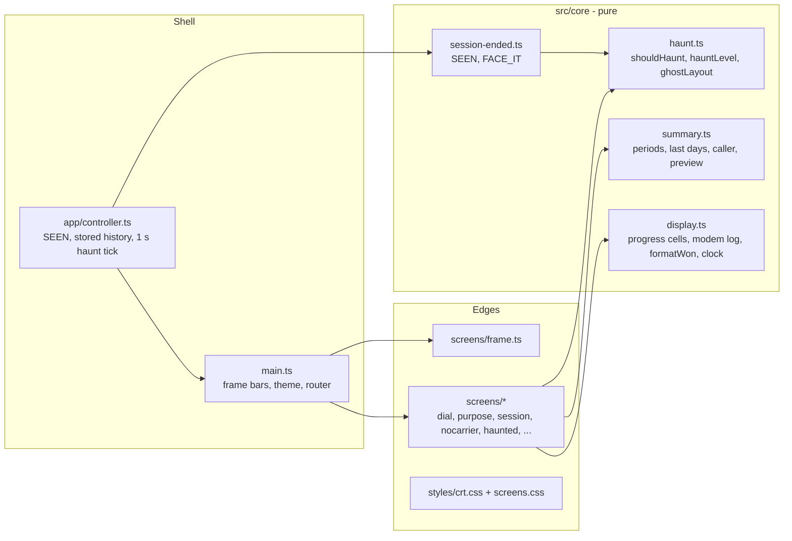
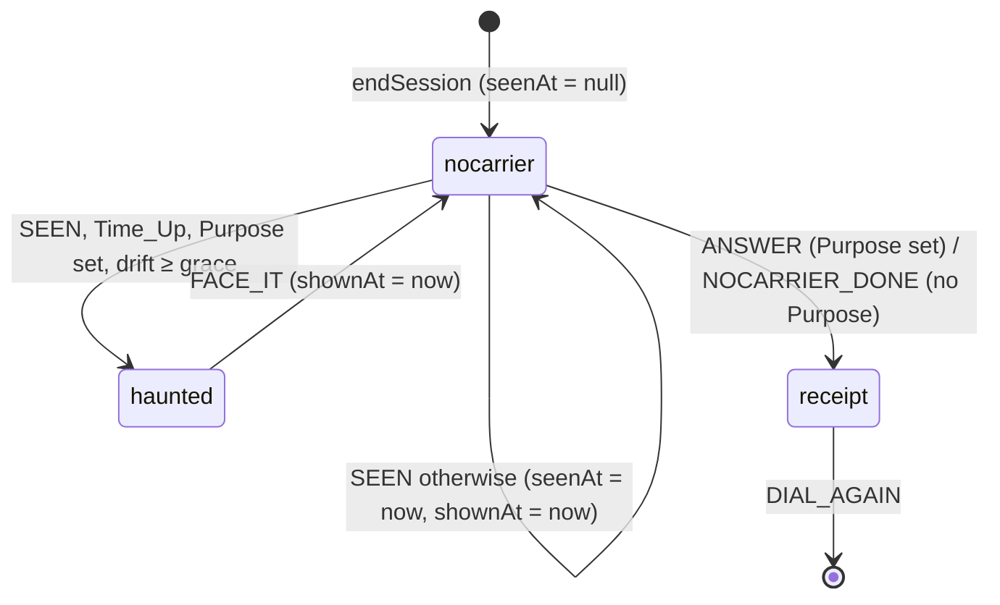

# Design Document: BLUELINE Design Refresh and Haunted Line

## Overview

This design applies `.kiro/steering/design.md` and `docs/mockups/*.dc.html` to every screen, and adds the Haunted_Screen. It keeps the three layers of the earlier designs:

1. **Pure core (`src/core`)**: new pure functions for the Haunted_Screen decision and strength, the ghost layout, the Progress_Bar, the dial-screen and receipt summaries, the modem log timeline, and number formatting. They take `now` as an argument and never touch the DOM.
2. **Shell (`src/app`, `src/main.ts`)**: the controller tells the core when the user first sees an ended Session (`SEEN`), keeps a snapshot of the stored history for the summaries, passes `now` to screens, and renders the Screen_Frame.
3. **Edges (`src/screens`, `src/styles`)**: screens build DOM from state and the view model. A new `screens/frame.ts` describes the Status_Bar and Function_Key_Bar per screen; `main.ts` draws them.

The flow, the commands, the stored formats, and the fee do not change. The only new behavior is the Haunted_Screen, which is one more ENDED view before NO CARRIER.

### Key design decisions

| Decision | Choice | Reason |
|---|---|---|
| When the user "first sees" an ended Session | New event `SEEN { now }`, dispatched by the controller the first time the tab is visible while an ENDED Session has `seenAt === null` (right after a visible Time_Up or Hang_Up, on resume, or at boot after a reload past the end). The reducer decides haunted or not from `now − record.end`. | One rule covers desktop hidden tabs (timers run, the Session ends while hidden), iPhone paused tabs (the Session ends on resume), and reloads. The decision stays pure and testable (Req 9.1, 9.2). |
| Haunted view | `ended.view` gains `'haunted'`, entered only from `SEEN` and left only by `FACE_IT { now }` to `'nocarrier'`. | Views still only move forward: haunted → nocarrier → receipt. The Message stays in `ended.memo` until NO CARRIER is left, so it is still shown at most once (Req 9.9, 9.10). |
| Timing values | `HAUNT = { normal: { graceSec: 60, fullSec: 600 }, demo: { graceSec: 10, fullSec: 60 } }` in `config.ts`; `hauntTiming(plannedSec)` returns `demo` for the 1 MIN (DEMO) duration. | One place for all four values (Req 9.7). |
| Ghosts | `ghostLayout(purpose, level)` in `core/haunt.ts` returns up to 6 ghosts (text, position in %, rotation, size, opacity), with corruption characters chosen by a small hash of the Purpose, so the same Purpose and level always give the same layout. | Pure and testable; no `Math.random`, so a re-render does not make the ghosts jump (Req 9.5, 9.6). |
| History for summaries | The controller keeps `stored: HistoryStatus` (read with `storage.loadHistory()` at boot, on entering IDLE, on entering SET_PURPOSE, and at connect; replaced by the `historyWritten` result after `endSession` and `saveOutcome`). Screens get it and `now` in the view model and call pure summary functions. | Screens stay free of storage and clock access; the summaries are pure (Req 4.5–4.8, 5.4, 7.4, 8.3). |
| Screen_Frame | `frameFor(view, state, vm)` in `screens/frame.ts` returns `{ theme, status, keys, hint }`; `main.ts` draws `#status-bar` and `#key-bar` around `#screen` and the Command_Prompt, and sets `document.body.dataset.theme` (`blue`, `black`, `haunted`). | One table of status texts and keys per view; the bars never rebuild the screen (Req 2.1–2.3). |
| Boxes | `box.ts` becomes a CSS box: `<div class="box box-double">` or `box-dashed` with plain rows. The `+ - \|` text and `SIDE_TEXT` are removed. | Req 2.4. Screen readers no longer have border characters to skip. |
| Display_Face sizes | CSS classes `.display-xl`, `.display-l`, `.display-m`, each stepping through multiples of 11 px by media query (below). | Keeps the 11-px pixel grid sharp (Req 1.3, 3.2). |
| Scanlines | `body::after`: `repeating-linear-gradient(to bottom, rgb(0 0 0 / 0.06) 0 1px, transparent 1px 3px)`, static. Haunted: a second, strong layer `rgb(0 0 0 / 0.28)`, and a stepped opacity flicker on the title and ghosts inside `@media (prefers-reduced-motion: no-preference)`. | Req 1.6, 1.7, 9.8. Contrast is checked below. |
| Version | `__APP_VERSION__` from `package.json`, set by Vite `define` in `vite.config.ts` and `vitest.config.ts`, declared in `src/env.d.ts`, read only in `screens/frame.ts`. | The real version, one source (confirmed decision 3). |
| Fee text | `formatWon(n)` with thousands separators (`₩1,840`) replaces `won()` everywhere. | The dial and preview totals can pass 1,000; one format everywhere avoids two styles of the same number. |

## Architecture



### ENDED views



Rules:

- `SEEN` is handled only while `view === 'nocarrier'` and `seenAt === null`; afterwards it does nothing. So the Haunted_Screen appears at most once per Session (Req 9.10).
- While `view === 'haunted'`: `FACE_IT` moves on; `ANSWER`, `NOCARRIER_DONE`, `MENU_KEY`, `BACK`, end events do nothing.
- While `view === 'nocarrier'` and `seenAt === null` (the tab has not been seen yet), `ANSWER` is still accepted. The user can only answer from a visible tab, and `SEEN` always comes first in that case, so this is only a safeguard.
- A reload while haunted: the active state was already cleared at `endSession`, so the reload goes to the Dial_Screen and the record stays NO ANSWER (Req 9.10).
- `ended` gains `seenAt: number | null` and `shownAt: number | null` (when NO CARRIER was first shown, for `SENT <MM:SS> AGO`). Neither is stored.

### Reloads: two cases (Req 9.12, 9.13)

A reload is told apart only by what is in storage, so the two cases cannot mix:

**(가) The active state is still stored and its scheduled end has passed.** This is the iPhone Safari case: the tab was paused in the background and the page is loaded again after Time_Up, before any NO CARRIER was handled.

1. `recover(storedActive, now)` ends the Session as a TIME UP with `end = start + plannedSec × 1000` and the fee for the Planned_Duration (unchanged core rule). Its `endSession` effect appends the NO ANSWER record and clears the active state, as before.
2. The state is ENDED / `nocarrier` with `seenAt = null` and the Message in `ended.memo`.
3. At boot the tab is visible, so the controller dispatches `SEEN { now: Date.now() }`. The load counts as the moment the user first sees the Session.
4. If `shouldHaunt(record, now)` holds (Time_Up, Purpose set, `now − end ≥ grace`), the view becomes `haunted`; `ENTER · FACE IT` then shows NO CARRIER with the Message and Y / N. Otherwise NO CARRIER with the Message and Y / N is shown at once.

**(나) NO CARRIER was already reached, with or without an answer.** `endSession` cleared the active state when the Session ended, so nothing is left to recover.

1. `recover(null, now)` returns IDLE: the Dial_Screen.
2. The stored record keeps its Outcome: NO ANSWER if the user left without answering, DONE or DRIFTED if they answered.
3. There is no ENDED state, so no `SEEN`, no Haunted_Screen, no Message, and no Y / N for that Session.

Both cases are tested at the reducer level (with `recover` and a fake storage slot) and in the browser (Testing Strategy).

### Controller changes

- **SEEN**: in `sync()` after entering ENDED, and in `page.onResume`, if `state.phase === 'ENDED' && state.ended.seenAt === null && page.isVisible()`, dispatch `SEEN { now: Date.now() }`. At boot, after `recover`, the same check runs. For a visible Time_Up, the 500 ms final `00:00` frame is shown first and `SEEN` is dispatched when it ends.
- **Haunt tick**: while the view is `haunted`, a 1 s interval re-renders; the screen computes the Drift_Time from `now − record.end` (no tick counting, Req 9.4).
- **NO CARRIER timer** (no Purpose): armed only after `SEEN`, as before.
- **Stored history snapshot** as in the decision table.
- `controller.ts` is 191 lines. The snapshot and SEEN logic go into a new `app/ended.ts` helper so the controller stays under 200 lines.

## Components and Interfaces

### `src/core/config.ts` (changed)

```ts
export const HAUNT = {
  normal: { graceSec: 60, fullSec: 600 },
  demo: { graceSec: 10, fullSec: 60 },
} as const;
export const DEMO_PLANNED_SEC = 60;           // the 1 MIN (DEMO) Planned_Duration
export const PROGRESS_CELLS = 20;
export const MODEM_LOG = [                     // ms after the Dial_Sequence start; CONNECT comes with HANDSHAKE_DONE
  { at: 0, text: 'ATZ' }, { at: 300, text: 'OK' }, { at: 600, text: DIAL_TEXT },
  { at: 1600, text: 'DIALING...' }, { at: 2400, text: 'RING... RING...' },
] as const;
export const CONNECT_TEXT = 'CONNECT 2400';
```

`DIAL_TEXT` (`ATDT 0145550199`) stays, so the dial number keeps 10 digits (confirmed decision 4). The `ATDT` line is still typed one character at a time from 600 ms, at the existing `TIMING.charMs`.

### `src/core/haunt.ts` (new)

```ts
export function hauntTiming(plannedSec: number): { graceSec: number; fullSec: number };
export function shouldHaunt(record: NewRecord, now: number): boolean;
// reason === 'TIME UP' && purpose !== null && now − end ≥ graceSec × 1000
export function hauntLevel(driftMs: number, plannedSec: number): number;
// clamp(driftMs / (fullSec × 1000), 0, 1); NaN or negative drift → 0
export interface Ghost { text: string; x: number; y: number; rotate: number; size: number; opacity: number }
export function ghostLayout(purpose: string, level: number): Ghost[];
```

`ghostLayout`: six fixed slots taken from the Haunted mockup (positions in % of the screen, rotation, size in multiples of 11 px). The number of slots shown is `ceil(6 × level)` (0 at level 0, 6 at level 1); each opacity is `slot.base × level`, at most 1. Slot texts: the Purpose, the Purpose with one or two characters replaced by `▒` or `█` at positions picked by a hash of the Purpose, its last word, the Purpose twice, and `…<last word>…<last word>`. The ASCII ghost is a separate constant shown when `level > 0`.

### `src/core/summary.ts` (new)

```ts
export interface Period { calls: number; fee: number; counts: Counts }
export function periods(records: readonly Pick<SessionRecord, 'end' | 'fee' | 'outcome'>[], now: number):
  { today: Period; week: Period };                 // same end-timestamp rules as totals() and outcomeCounts()
export function lastDays(records: ..., now: number, days: number): Counts;
// end within local 00:00 of (today − days + 1) .. now (Req 5.4, confirmed decision 10)
export function callerNumber(history: HistoryStatus | null): number;   // largest stored no + 1, or 1
export function lastCall(history: HistoryStatus | null, now: number): string | null;
// 'TODAY 23:41 · 18:02 ON LINE · DRIFTED', or null when there is no record (screen shows FIRST CALL. WELCOME.)
export function todaySoFar(history: HistoryStatus | null, sessionStart: number, currentFee: number):
  { calls: number; fee: number };                  // records ended today before the start, + this Session
export function preview(record: NewRecord, history: HistoryStatus | null, now: number):
  { today: Period; week: Period; postNo: number | null };
```

`preview` counts the stored records (which already include the ended Session as NO ANSWER, Req 8.3) and, for `unavailable`, only `[record]` with `postNo = null` (Req 8.4). `periods` reuses `periodStarts` from `history.ts`.

### `src/core/display.ts` (new)

```ts
export function progressCells(elapsedSec: number, plannedSec: number): number; // floor(20 × e / p), clamped 0..20
export function progressBar(cells: number): string;                          // '▓' × cells + '░' × (20 − cells)
export function formatWon(n: number): string;                                // '₩1,840'
export function formatClock(sec: number): string;                            // MM:SS, capped at 99:59
export function modemLines(elapsedMs: number, connectShown: boolean): { text: string; cls: string }[];
export function charCounter(text: string, max: number): { text: string; over: boolean }; // '12/60'
```

### `src/core/session-state.ts` and `src/core/session-ended.ts` (changed)

- `ended: { record; view: 'haunted' | 'nocarrier' | 'receipt'; memo; seenAt: number | null; shownAt: number | null }`.
- Events `SEEN { now }`, `FACE_IT { now }`. `USER_INPUTS` gains `FACE_IT` (not `SEEN`, which is not a user input).
- `endedStep` implements the rules above. It stays under 80 lines.

### `src/core/commands.ts` (changed)

- `ViewName` gains `'haunted'`. `viewOf`: ENDED with `view === 'haunted'` → `haunted`.
- `haunted` accepts `help`; empty Enter is FACE_IT (in `keys.enter()`); every other input → `PRESS ENTER TO FACE IT`.
- `help` lines for `haunted`: `ENTER - FACE IT`, `HELP - SHOW COMMANDS`.

### `src/screens/frame.ts` (new)

```ts
export type Theme = 'blue' | 'black' | 'haunted';
export interface Frame { theme: Theme; status: string[]; badge?: string; keys: [string, string][]; hint?: string }
export function frameFor(view: ViewName, state: AppState, vm: ViewModel): Frame;
```

| View | Theme | Status context | Line status | Keys |
|---|---|---|---|---|
| dial | blue | `COM1 · 2400 BPS · 8N1` | `OFF LINE` (`DIALING...` while dialing) | `ENTER` DIAL, `HELP` 도움말 (HELP) |
| destination | blue | `MAIN MENU` | `CONNECTED · NOT ON LINE YET` | `1-4` SELECT, `GO YT/IG`, `HELP` |
| urlEntry | blue | `ENTER URL` | same | `ENTER` SUBMIT, `BACK` |
| board | blue | `BOARD · PAGE p/n` | same | `N` OLDER, `P` NEWER, `0/ESC` BACK |
| purpose, memo | blue | `DESTINATION: <n>. <LABEL>` | same | `ENTER` NEXT, `ESC` BACK, hint `한글 입력 중 Enter는 제출되지 않음 (ENTER WHILE COMPOSING HANGUL DOES NOT SUBMIT)` |
| duration | blue | `DESTINATION: <LABEL>` | same | `1-5` DURATION, `0` BACK |
| confirm | blue | `CONNECT?` | same | `ENTER` CONNECT, `0/ESC` BACK |
| session | blue | `DESTINATION: <LABEL> (OPENED IN NEW TAB)` | badge `● ON LINE` | `ESC` HANG UP, `BYE` HANG UP, hint `이 탭은 열어 두세요 · 시간이 되면 회선이 끊깁니다 (KEEP THIS TAB OPEN · THE LINE DROPS AT TIME UP)` |
| nocarrier, nocarrierCheck | black | `NO CARRIER` | `OFF LINE` | `Y` DONE, `N` DRIFTED, hint (Req 8.5); without a Purpose: `ENTER` RECEIPT |
| haunted | haunted (dark red bar) | `LINE STATUS: UNSTABLE` | `░▒▓ SIGNAL ▓▒░` | `ENTER` FACE IT |
| receipt | blue | `RECEIPT` | `OFF LINE` | `1` DIAL AGAIN |

The Status_Bar always starts with `BLUELINE <version>` and includes `FEE ₩40/MIN (FICTIONAL)` except on the NO CARRIER and haunted screens (as in the mockups). Neither bar includes the Purpose or the Message (Req 2.2).

### Screens

| File | Change |
|---|---|
| `dial.ts` | Two columns: Modem_Log (from `modemLines`, driven by `vm.dialElapsedMs`) and the `box-double` info box: `BLUELINE` (`.display-l`, yellow), the tagline, `반갑습니다 ^^  WELCOME BACK, CALLER #0017`, last call, this week, `ENTER · DIAL IN` (grey fill). A tap anywhere still dials. |
| `purpose.ts` | Title `[ STATE YOUR PURPOSE ]` with the Korean hint and `(WHAT ARE YOU HERE TO DO?)`; cyan label; field on black; Character_Counter updated in the field's `input` handler with `charCounter`; dashed Sysop_Notice from `lastDays(…, 7)`; `ESC · BACK` and `ENTER · NEXT` buttons (`ENTER · NEXT` calls `form.requestSubmit()` so the IME rule still applies). Message_Screen: same frame, the Purpose read-only above, yellow text, counter `/120`. |
| `session.ts` | Purpose_Band; two big numbers (`.display-xl`) with `ON LINE` / `OF <MM:SS> BOOKED` and `FEE SO FAR` / `₩40 PER STARTED MINUTE · FICTIONAL`; Progress_Bar with an `aria-label` like `75% OF BOOKED TIME`; `<MM:SS> LEFT · TODAY <n> CALLS · ₩<fee>`; `ESC · HANG UP` (hangup-red) and `OR TYPE BYE`. The 250 ms updates still change text only (`fill`). |
| `nocarrier.ts` | Black theme; main column (`+++ ATH0`, `NO CARRIER` `.display-xl`, booked / on line / fee, Message box `box-double` yellow with `SENT <MM:SS> AGO`, Purpose, question, green `Y · YES (DONE)` and outline `N · NO (DRIFTED)`); Receipt_Preview column (dashed left border) from `preview`. Without a Purpose: no question, core hint, tap moves on. |
| `haunted.ts` (new) | Ghost layer (`aria-hidden`, `pointer-events: none`) from `ghostLayout`, ASCII ghost, strong scanline layer; content (title `.display-l` red with cyan offset, drift lines, red box with `YOU SAID, <MM:SS> AGO` and the Purpose, billed line, `ENTER · FACE IT`). Drift texts are slots updated each second. |
| `menu.ts`, `confirm.ts`, `receipt.ts`, `board.ts` | Frame, Key_Buttons, CSS boxes; content unchanged. |
| `box.ts` | CSS boxes as described. |
| `view.ts` | `ViewModel` gains `now`, `stored: HistoryStatus \| null`, `dialElapsedMs`; `Handlers` gains `faceIt()`. `won()` is replaced by `formatWon`. |

### Styles

- `crt.css`: tokens (the Palette as CSS variables), themes on `body[data-theme]`, frame bars, Key_Buttons (48 px, square), inputs on black, faint Scanline_Layer, focus outline (yellow).
- `screens.css`: boxes, two-column layouts (stack below 600 px), Purpose_Band, big numbers, Progress_Bar, NO CARRIER columns, Board.
- `haunted.css` (new): ghost layer, strong scanlines, flicker (only under `prefers-reduced-motion: no-preference`).

Display_Face sizes (GalmuriMono11 Latin glyphs are half an em wide, so `n` characters need `n × size / 2`):

| Class | Used for | ≥ 960 px | 720–959 px | 600–719 px | < 600 px |
|---|---|---|---|---|---|
| `.display-xl` | `NO CARRIER` (10 ch), session numbers (5 ch each) | 110 px | 88 px | 66 px | 44 px |
| `.display-l` | `BLUELINE` (8 ch) | 88 px | 88 px | 66 px | 44 px |
| `.display-m` | `THE LINE IS HAUNTED` (19 ch, may wrap) | 77 px | 66 px | 55 px | 33 px |

The browser check measures the real glyph width and that no Display_Face line overflows at 360 px.

### Contrast with the Scanline_Layer

The faint layer darkens covered pixels by 6% (relative luminance × about 0.87). The worst pairs, with the text darkened and the background not:

| Pair | Ratio | Strong haunted layer (× 0.49) |
|---|---|---|
| text-dim `#AAAAAA` on bg-blue | 5.8:1 | — |
| black on bar-cyan `#00AAAA` | 6.5:1 | — |
| white on hangup-red `#AA0000` | 7.0:1 | — |
| text-dim `#AAAAAA` on bg-black | 7.9:1 | — |
| `#FF9999` on bg-haunted | — | 5.1:1 |
| white on bg-haunted | — | 9.8:1 |

A unit test computes these from the Palette and the overlay factors, so a palette change cannot slip below 4.5:1 unnoticed (Req 1.7).

## Correctness Properties

Each property test runs at least 100 fast-check cases and is tagged `// Feature: blueline-design, Property N: <title>`.

### Property 1: Haunt level stays in range and never decreases

*For any* Planned_Duration and drift times `d1 ≤ d2`, `hauntLevel(d, p)` is in `[0, 1]`, is 0 at `d = 0`, is 1 for `d ≥ fullSec × 1000`, and `hauntLevel(d1, p) ≤ hauntLevel(d2, p)`. The demo duration uses 60 s and others 600 s.

**Validates: Requirements 9.6, 9.7**

### Property 2: Haunted only for a late return to a Time_Up with a Purpose

*For any* record and `now`, `shouldHaunt` is true exactly when the reason is TIME UP, the Purpose is set, and `now − end ≥ graceSec × 1000` (10 s for the demo duration, 60 s otherwise).

**Validates: Requirements 9.1, 9.2**

### Property 3: Ended views move forward, and the Haunted_Screen appears at most once

*For any* ENDED state and event sequence (with `SEEN`, `FACE_IT`, answers, timers, end events), the view sequence for the Session is a subsequence of `nocarrier → haunted → nocarrier → receipt` with `haunted` at most once and only right after the first `SEEN`; the Outcome changes only on `ANSWER` from `nocarrier`; the record's fee never changes.

**Validates: Requirements 9.9, 9.10, 9.11, purpose-board 10.3**

### Property 4: The Message is still shown at most once

Purpose-board Property 5, extended with `SEEN`, `FACE_IT`, and reloads during the haunted view: no Session shows its Message on more than one NO_CARRIER_Screen, and the Haunted_Screen never shows it.

**Validates: Requirements 8.7, 9.10**

### Property 5: Progress_Bar

*For any* Planned_Duration and elapsed seconds `e1 ≤ e2`, `progressCells` is in `0..20`, equals `floor(20 × e / p)` for `e ≤ p`, and is non-decreasing; `progressBar(c)` has exactly 20 characters with `c` `▓`.

**Validates: Requirement 7.3**

### Property 6: Summaries match the receipt rules

*For any* history of 0–1000 records and `now`: `periods(records, now)` has the same fees as `totals()` and the same counts as `outcomeCounts()`, and `calls` equals the number of records in the period; `lastDays(records, now, 7)` equals a reference filter on local calendar dates; `callerNumber` is the largest stored `no` + 1 (1 when empty).

**Validates: Requirements 4.4, 4.6, 5.4, 8.3**

### Property 7: Number formats

*For any* whole number `n ≥ 0`, `formatWon(n)` is `₩` followed by `n` with commas every three digits, and removing `₩` and commas gives `n` back. `formatClock(s)` is `MM:SS` for `s ≤ 5999` and `99:59` above.

**Validates: Requirements 4.6, 8.2, 9.3**

## Error Handling

| Case | Handling | Requirement |
|---|---|---|
| Storage unavailable or unreadable | Dial shows `FIRST CALL. WELCOME.` and zeros; Sysop_Notice zeros; Session today from this Session only; preview from this Session only, no Post_Number line | 4.7, 8.4 |
| Clock moved back after the drop (`now < end`) | Drift 0, no haunt, level 0 | 9.6 |
| Session with no Purpose ends by Time_Up after a long time away | No Haunted_Screen; NO CARRIER moves on as before | 9.2 |
| Reload while haunted | Dial_Screen, NO ANSWER kept (active state already cleared) | 9.10 |
| Reduced motion | No flicker; ghosts static; scanlines static | 1.6, 9.8 |

## Testing Strategy

- **Property tests** (`tests/property/`): `haunt.prop.test.ts` (Properties 1, 2), `ended.prop.test.ts` (Property 3, extending purpose-board Property 13), `memo.prop.test.ts` (Property 4), `display.prop.test.ts` (Properties 5, 7), `summary.prop.test.ts` (Property 6, also in the `new-york` project).
- **Unit tests** (`tests/unit/`): `lastCall` texts (TODAY / YESTERDAY / date), `FIRST CALL`, `ghostLayout` counts at levels 0, 0.5, 1 and determinism, `modemLines` order, `charCounter` over the limit, `frameFor` keys per view and no Purpose in the bars, contrast table (Req 1.7), commands on `haunted`.
- **Reload cases** (`tests/unit/reload.test.ts`):
  - (가) A stored v2 active state with a Purpose and a Message, loaded 15 s after the scheduled end with the 1 MIN (DEMO) duration: `recover` + `SEEN` gives the `haunted` view; the record has `end` = the scheduled end and the 60-second fee; `FACE_IT` gives NO CARRIER with the Message; `ANSWER` writes the Outcome. The same at 5 s after the end gives NO CARRIER directly (within the Grace_Period).
  - (나) After NO CARRIER was reached (answered and not answered), the fake storage holds no active state; a reload gives IDLE, the stored Outcome is unchanged, and no `SEEN`, haunted view, or Message follows.
  - The browser check repeats both: (가) by writing an expired active state to `localStorage` and reloading; (나) by reloading on NO CARRIER and on the receipt.
- **Existing tests**: texts that this spec changes (for example `PRESS ENTER OR TAP TO DIAL`, `TYPE BYE OR PRESS ESC TO HANG UP`, ASCII box output) are updated; behavior assertions stay.
- **Browser checks** (headless Chrome, 360 / 1280 px, scripts outside the repo): every screen's frame, no horizontal scroll, Display_Face fits, palette-only colors (computed styles), focus outline, Haunted_Screen after a hidden Time_Up with the demo duration (10 s), level growth over 60 s, reduced motion off, then NO CARRIER with the Message; demo timing both ways.
- **Manual checks** (`docs/manual-checks.md` part D): the open rows of part B and C2, plus the Haunted_Screen on a desktop browser and on iPhone Safari, and a look at the mockups side by side.

## Demo Timing

Returning before Time_Up (no Haunted_Screen): unchanged, about 100.7 s (Req 12.4).

Staying away past Time_Up with the 1 MIN (DEMO) duration (Req 12.5):

| Step | Time |
|---|---|
| Dial, five inputs, handshake (as before) | ≈ 34.9 s to the Session start |
| Session | 60 s → drop at ≈ 94.9 s |
| User returns 10–30 s after the drop (Grace_Period 10 s) | ≤ 124.9 s |
| Enter on the Haunted_Screen | ≤ 5 s → 129.9 s |
| Y or N on NO CARRIER | ≤ 5 s → 134.9 s |
| **Receipt** | **< 136 s** (limit 150 s) |

## File Plan

| Folder | New | Changed |
|---|---|---|
| `src/core/` | `haunt.ts`, `summary.ts`, `display.ts` | `config.ts`, `session-state.ts`, `session-ended.ts`, `commands.ts` |
| `src/app/` | `ended.ts` | `controller.ts`, `keys.ts`, `input.ts` |
| `src/screens/` | `frame.ts`, `haunted.ts` | all other screens, `box.ts`, `view.ts` |
| `src/styles/` | `haunted.css` | `crt.css`, `screens.css` |
| `src/` | `env.d.ts` | `main.ts` |
| root | | `index.html` (status and key bars), `vite.config.ts`, `vitest.config.ts` (`__APP_VERSION__`) |
| `docs/` | | `manual-checks.md` (part D) |
| `.kiro/steering/` | | `structure.md` |
| root | `README.md` | |

The earlier spec files are not changed.

## Resolved in Design Review

1. **Modem_Log timing.** Approved: `ATZ`, `OK`, then the existing `ATDT 0145550199` typed one character at a time, `DIALING...`, `RING... RING...` inside the 4 s handshake, and `CONNECT 2400` when the handshake ends. No change to the sound.
2. **`₩` with thousands separators everywhere.** Approved, including the receipt.
3. **Ghost layout is deterministic** from the Purpose. Approved.
4. **Reloads.** Added in review: the two cases (가) and (나) above, each tested.
