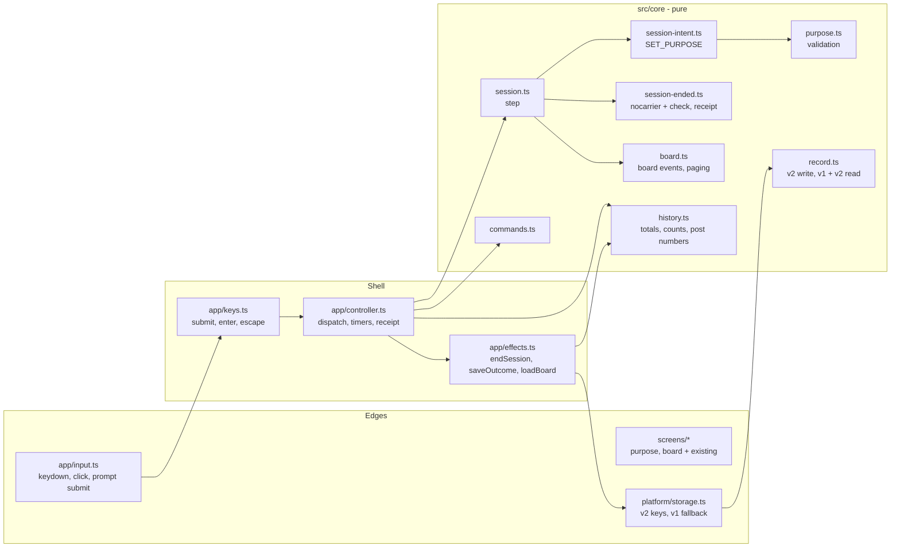

# Design Document: BLUELINE Purpose, Message, Purpose Check, and Board

## Overview

This design adds the purpose-board feature (`requirements.md` in this folder) to the existing BLUELINE app. The new flow is:

Dial → Destination → **Purpose** → **Message** → Duration → Connect confirm → Session → NO CARRIER (**with the Message and the Purpose check**) → Receipt (**with Purpose, Outcome, and Outcome counts**)

and, from the Destination_Menu, `4. BOARD` → Board → back to the Destination_Menu.

The design keeps the three layers of the core design (`.kiro/specs/blueline-core-flow/design.md`, the core design):

1. **Pure core (`src/core`)**: validation, the state machine, record formats, post numbers, Outcome counts, and board paging. Core functions take `now` as an argument, never touch the DOM or browser APIs, never call `Date.now()`, and do not import from `app`, `screens`, `audio`, or `platform`.
2. **Shell (`src/main.ts`, `src/app/*`)**: owns the one mutable `AppState`, turns DOM input into core events, runs the effects the core returns, and drives timers.
3. **Edges (`src/screens`, `src/audio`, `src/platform`)**: screens build DOM from state and view model; `platform/storage.ts` wraps `localStorage`.

The reducer still returns effects as data: `step(state, event) → { state, effects }`. The new rules that matter most ("show the Message at most once", "record NO ANSWER before the user can leave", "post numbers never change") become properties of pure functions and are tested with fast-check. Every file stays under about 200 lines; `session.ts`, `record.ts`, and `controller.ts` are split to stay within that limit.

### Naming in code

| Requirement term | Code name | Why |
|---|---|---|
| Message (to future you) | `memo` | `AppState.message` already holds status text such as `INVALID SELECTION`. |
| Purpose | `purpose` | |
| Outcome | `outcome`: `'DONE' \| 'DRIFTED' \| 'NO ANSWER'` | Same words as the requirements and the screens, so stored values, code, and UI use one term each. |
| Post_Number | `no` | Short field name in stored JSON. |
| Purpose_Screen / Message_Screen | views `purpose` / `memo` | |
| NO_CARRIER_Screen with the Purpose_Check | view `nocarrierCheck` (Session has a Purpose); view `nocarrier` (no Purpose) | Both are drawn by `screens/nocarrier.ts`; the view name decides commands, keys, and the timer. |
| Board_Screen | view `board` | |

### Key design decisions

| Decision | Choice | Reason |
|---|---|---|
| Message shown at most once | The memo lives only in the Active_Session_State and in memory (`Session.memo`, then `ended.memo`). Ending a Session clears the Active_Session_State (existing `endSession` effect) and moves the memo from `session` to `ended.memo`. `NOCARRIER_DONE` sets `ended.memo = null`. ENDED views only move forward. `SessionRecord` has no memo field. | After the one NO CARRIER view, no copy of the memo is left in state or storage, so no later event or reload can show it again (Req 4.4, 4.5). |
| NO CARRIER and the Purpose check | One screen. With a Purpose, the ENDED `nocarrier` view leaves only on `ANSWER`; `NOCARRIER_DONE` is ignored, and the controller arms no 3 s timer. Without a Purpose, `NOCARRIER_DONE` moves on as in the core spec. | Decided in review after task 4. Answering right at the disconnect needs one fewer step, and waiting for the answer gives a Message time to be read. Ignoring `NOCARRIER_DONE` in the reducer also covers a stray timer or tap (Req 5.1, 5.2, 5.9). |
| Outcome before the answer | `endRecord` creates the record with `outcome: 'NO ANSWER'`, and the existing `endSession` effect writes it before NO CARRIER is shown. | A reload, a closed tab, or a crash before the answer leaves NO ANSWER in storage without any extra write (Req 5.5). |
| Writing the answer | `ANSWER { yes }` sets `ended.record.outcome`, moves to the receipt view, and returns `saveOutcome { start, outcome }`. The effect runner loads history, calls the pure `setOutcome(records, start, outcome)`, saves, and reports the result through `host.historyWritten`. | Keeps the write in the shell and the logic pure. Matching by `start` works because the ended state does not know the Post_Number, and two Sessions cannot share a start timestamp (each comes from a separate open). Only the first answer counts, because the view leaves `nocarrier` (Req 5.7, 8.9). |
| Post numbers | Stored per record as `no`. `appendRecord(records, r)` sets `no = (last record's no ?? 0) + 1`, then keeps the newest 1000. v1 history is numbered 1..n on read. v2 parsing rejects the whole text unless every `no` is a positive safe integer and the numbers increase strictly in stored order. | Numbers increase strictly, and the cap removes the oldest records first, so the last record always holds the largest number ever given out. No separate counter is needed (Req 13.1–13.6). A reset history starts again at 1 (Req 13.7). |
| Outcome counts | New pure `outcomeCounts(records, now)` uses the same end-timestamp rule as `totals()`. `totals()` and `fee` are not changed. | Fee and time totals for legacy records stay identical because the code that computes them does not change (Req 8.4). |
| Board loading | `MENU_KEY 4` sets `board = { page: 1, history: null }` and returns `loadBoard`. The effect runner calls `storage.loadHistory()` and queues `BOARD_LOADED { history }` in the same call stack, like `openDestination` → `OPENED`. | The reducer stays pure, and the Board is never rendered before the history arrives. The Board never writes (Req 7.11). |
| Text fields | Each field sits in a `<form>` and submits on the form's `submit` event (implicit submission on Enter or the phone keyboard's Next key). A `keydown` listener notes whether that Enter belonged to a composition (`e.isComposing` or `e.keyCode === 229`); if it did, that one submit is ignored. Escape is handled once, by the global listener in `input.ts`, which also skips composing key presses. No `maxLength`. The Command_Prompt form is hidden on these screens. Changed during task 4 from a keydown-only submit. | A Hangul IME can send an Enter that only commits the last syllable. Ignoring it and submitting on the next real Enter submits once, with every Character (Req 3.6, 3.7). The form submit also works for phone keyboards that report every key as 229. Handling Escape in one place avoids going back two screens at once. Over-long text is rejected on Enter, not cut while typing, so composition is never broken (confirmed decision 8). |
| Shared state module | Types, `initialState`, and the small state helpers (`same`, `say`, `toDestMenu`) live in `src/core/session-state.ts`. `session.ts` re-exports them. Added during task 4. | `session-intent.ts` (and later `session-ended.ts` and `board.ts`) need these helpers, and `session.ts` needs those reducers. Importing from one shared module avoids an import cycle. |
| Character count | `[...text.trim()].length` (Unicode code points). | Matches the glossary. JS `trim()` also removes U+3000 (ideographic space) and NBSP. |
| Storage keys | History is written to `blueline.history.v2` and the active session to `blueline.active.v2`. Reads try the v2 key first and fall back to the v1 key. The v1 history key is never written or removed. `clearActive` removes both active keys. | If the new build is rolled back, the old build still finds the pre-feature history. Both active keys are cleared so an old v1 active session cannot be recovered again after it ended. **To confirm in design review.** |
| Plain-text display | Purpose and Message are always set with `textContent` (the existing `el`, `line`, `pair` helpers). | No HTML interpretation (Req 11.3). |
| Privacy | `notifyTimeUp` text and `page.ts` title text are not changed. | Tab title and notification never include Purpose or Message (Req 1.9, 11.6). |
| Box height | `box.ts` `SIDE_TEXT` grows from 8 to 12 lines. | A 60-Hangul Purpose is 120 columns and wraps to 5 rows inside the 28-column box content. 12 leaves room for emoji and narrow viewports. |
| Outcome words | Stored and shown as `DONE`, `DRIFTED`, `NO ANSWER`. The receipt always shows the words. The Board renders both the words and `Y`/`N`/`?` and lets a 600 px media query pick one. | Readable counts were asked for in design review. Picking the form in CSS keeps the core free of viewport logic and switches on rotate with no re-render (Req 6.2, 7.3). |

## Architecture



The dispatch loop is unchanged: `step`, run each effect (effects may queue follow-up events that run in the same call stack), `sync` timers and the receipt model, then render once.

### Session state machine

```mermaid
stateDiagram-v2
  [*] --> IDLE
  [*] --> CONNECTED: reload, valid active (v1 or v2), not expired
  [*] --> ENDED: reload, valid active, expired
  IDLE --> DIALING: DIAL
  DIALING --> SELECT_DEST: SHOW_MENU
  state SELECT_DEST {
    menu --> url: 3
    url --> menu: back
    menu --> board: 4
    board --> menu: 0 / Esc / back / BACK
  }
  SELECT_DEST --> SET_PURPOSE: destination selected (1, 2, go yt/ig, accepted URL)
  state SET_PURPOSE {
    purpose --> memo: purpose accepted
    memo --> purpose: Esc / BACK
  }
  SET_PURPOSE --> SELECT_DEST: Esc / BACK on purpose (destination and intent cleared)
  SET_PURPOSE --> SELECT_DURATION: memo submitted (empty = skip)
  SELECT_DURATION --> SET_PURPOSE: 0 / back on the Duration_Menu (memo view)
  SELECT_DURATION --> SELECT_DURATION: duration picked → confirm; back on confirm → Duration_Menu
  SELECT_DURATION --> CONNECTED: CONFIRM → OPENED / LINK_OPENED
  CONNECTED --> ENDED: TIME UP / HANG UP
  state ENDED {
    nocarrier --> receipt: ANSWER (purpose set)
    nocarrier --> receipt: NOCARRIER_DONE (no purpose)
  }
  ENDED --> IDLE: DIAL_AGAIN (receipt view)
```



Any event not listed for the current phase and view returns the same state and no effects. There is no transition from `receipt` back to `nocarrier` (Req 10.3).

### Timing plan for the 1 MIN demo (Req 12)

The BLUELINE-controlled waits are the same as in the core design. `TIMING` in `src/core/config.ts` is not changed.

| Step | Who waits | Time |
|---|---|---|
| First Enter on the Dial_Screen | user | 0 s (start of the clock) |
| Handshake, CONNECT, Destination_Menu | BLUELINE | 4.0 + 0.1 + 0.8 = 4.9 s |
| Pick a destination | user | ≤ 5 s |
| Type a Purpose of up to 20 Characters + Enter | user | ≤ 10 s |
| Enter on the empty Message_Field | user | ≤ 5 s |
| Pick 1 MIN (DEMO) | user | ≤ 5 s |
| Enter on the Connect_Confirm_Screen | user | ≤ 5 s |
| Session | BLUELINE | 60 s |
| Time_Up detection + final `00:00` frame | BLUELINE | ≤ 0.75 s |
| Press Y or N on the NO_CARRIER_Screen | user | ≤ 5 s |
| **Total** | | **≈ 100.7 s** (35 s user + 65.7 s BLUELINE; limit 150 s) |

The NO_CARRIER_Screen of a Session with a Purpose waits for Y or N (Req 5.2), which is user time, so the core 3 s NO CARRIER wait drops out of the BLUELINE-controlled waits.

## Data Models

### Core types

```ts
// src/core/record.ts
export type Outcome = 'DONE' | 'DRIFTED' | 'NO ANSWER';
export const OUTCOMES: readonly Outcome[];

export interface SessionRecord {
  no: number;               // Post_Number, set by appendRecord or by the v1 reader
  start: number; end: number; plannedSec: number; actualSec: number;
  fee: number; reason: EndReason; label: Label;
  purpose: string | null;   // null only for Legacy_Records and legacy active sessions
  outcome: Outcome;
}
/** A record before it is appended: endRecord makes it, appendRecord numbers it. */
export type NewRecord = Omit<SessionRecord, 'no'>;

export interface ActiveSession {
  start: number; plannedSec: number; label: Label;
  purpose: string | null;   // null only when read from a v1 active session
  memo: string | null;
}

// src/core/session.ts
export type Phase = 'IDLE' | 'DIALING' | 'SELECT_DEST' | 'SET_PURPOSE' | 'SELECT_DURATION' | 'CONNECTED' | 'ENDED';
export interface Session {
  id: number; start: number; plannedSec: number; label: Label;
  purpose: string | null; memo: string | null;
}
export interface Intent { purpose: string | null; memo: string | null }
export interface Board { page: number; history: HistoryStatus | null }

export interface AppState {
  // existing fields: phase, seq, message, dial, urlEntry, destination, confirm, pending, notifyAsked, session
  intent: Intent | null;             // SET_PURPOSE and SELECT_DURATION; cleared on the Destination_Menu and at connect
  textStep: 'purpose' | 'memo';      // which field SET_PURPOSE shows
  board: Board | null;               // SELECT_DEST only; non-null while the Board_Screen is shown
  ended: {
    record: NewRecord;               // outcome changes once, on ANSWER
    view: 'nocarrier' | 'receipt';
    memo: string | null;             // set only while view === 'nocarrier'
  } | null;
}
```

`HistoryStatus` stays in `history.ts`; `session.ts` imports it as a type only.

### New events and effects

```ts
export type Event = /* existing */
  | { type: 'PURPOSE_SUBMIT'; text: string }
  | { type: 'MEMO_SUBMIT'; text: string }
  | { type: 'ANSWER'; yes: boolean }
  | { type: 'BOARD_LOADED'; history: HistoryStatus }
  | { type: 'BOARD_PAGE'; dir: 'next' | 'prev' }
  | { type: 'TYPING' };              // clears the message (Req 1.7)

export type Effect = /* existing */
  | { type: 'saveOutcome'; start: number; outcome: Outcome }
  | { type: 'loadBoard' };
// changed: { type: 'endSession'; record: NewRecord }
```

`PURPOSE_SUBMIT`, `MEMO_SUBMIT`, `ANSWER`, `BOARD_PAGE`, and `TYPING` are user inputs, so they clear the previous message before they are handled (existing `USER_INPUTS` rule).

### Stored format v2

```jsonc
// localStorage "blueline.history.v2"
{ "v": 2, "records": [
  { "no": 1, "start": 1794200000000, "end": 1794200060000, "plannedSec": 60, "actualSec": 60,
    "fee": 40, "reason": "TIME UP", "label": "YOUTUBE", "purpose": null, "outcome": "NO ANSWER" },
  { "no": 2, "start": 1794300000000, "end": 1794300042000, "plannedSec": 300, "actualSec": 42,
    "fee": 40, "reason": "HANG UP", "label": "CUSTOM", "purpose": "강의 영상 하나만 보기", "outcome": "DONE" }
] }

// localStorage "blueline.active.v2"
{ "v": 2, "start": 1794300000000, "plannedSec": 300, "label": "CUSTOM",
  "purpose": "강의 영상 하나만 보기", "memo": "다 봤으면 바로 끄자" }
```

- `purpose: null` is the "no Purpose" marker (Req 8.2). It appears only in records read from v1 or ended from a v1 active session.
- No shape has a URL field. History records have no memo field. The serializers write only the listed fields.
- v1 shapes are unchanged from the core design and are only read.

## Components and Interfaces

### `src/core/config.ts` (changed)

```ts
export const MAX_PURPOSE = 60;
export const MAX_MEMO = 120;
export const BOARD_PAGE_SIZE = 20;
export const NO_PURPOSE = '(NO PURPOSE)';
export const OUTCOME_LABEL = { DONE: 'DONE', DRIFTED: 'DRIFTED', 'NO ANSWER': 'NO ANSWER' } as const;
export const OUTCOME_SHORT = { DONE: 'Y', DRIFTED: 'N', 'NO ANSWER': '?' } as const;
export const NARROW_MAX_PX = 599; // Narrow viewport: below 600 CSS px (used by crt.css; kept here as the one number)
```

`TIMING`, `DURATIONS`, `FEE_RATE`, and `MAX_HISTORY` stay as they are.

### `src/core/purpose.ts` (new)

```ts
export function charCount(text: string): number;              // [...text].length
export type PurposeResult = { ok: true; purpose: string } | { ok: false; error: 'EMPTY' | 'TOO_LONG' };
export function validatePurpose(raw: string): PurposeResult;  // trim; 1..60 → ok (Req 1.2–1.6)
export type MemoResult = { ok: true; memo: string | null } | { ok: false };
export function validateMemo(raw: string): MemoResult;        // trim; '' → null; 1..120 → text; else not ok (Req 2.2–2.5)
export function isStoredPurpose(v: unknown): v is string;     // string, v === v.trim(), 1..60
export function isStoredMemo(v: unknown): v is string;        // string, v === v.trim(), 1..120
```

Messages: `PURPOSE REQUIRED`, `PURPOSE TOO LONG - MAX 60 CHARS`, `MESSAGE TOO LONG - MAX 120 CHARS`.

### `src/core/session.ts` (changed)

Keeps the dispatcher and the dial, destination, URL, duration, confirm, connecting, and connected handlers. Changes:

- `toDuration` becomes `toPurpose`: selecting a destination (1, 2, `go`, accepted URL) → `SET_PURPOSE`, `textStep = 'purpose'`, `intent = null` (Req 1.1).
- `toDestMenu` also clears `intent` and `board` (Req 1.8, 3.3).
- Destination menu: `MENU_KEY 4` → `board = { page: 1, history: null }`, effect `loadBoard`. 0 and 5–9 → `INVALID SELECTION` (Req 7.1, 7.2).
- While `state.board` is set, events go to `boardStep` in `board.ts`.
- Duration menu: `BACK` or `MENU_KEY 0` → `SET_PURPOSE` with `textStep = 'memo'`; destination and intent kept (Req 3.5).
- Connecting: the new `Session` takes `purpose` and `memo` from `intent`; `saveActive` includes both; `intent = null` (Req 9.1).
- `step` routes `SET_PURPOSE` to `intentStep` and `ENDED` to `endedStep`.

### `src/core/session-intent.ts` (new)

`intentStep(state, event)` for `SET_PURPOSE`:

| View | Event | Result |
|---|---|---|
| purpose | `PURPOSE_SUBMIT` valid | `intent = { purpose, memo: intent?.memo ?? null }`, `textStep = 'memo'` (Req 1.3) |
| purpose | `PURPOSE_SUBMIT` invalid | message `PURPOSE REQUIRED` or `PURPOSE TOO LONG - MAX 60 CHARS` (Req 1.4, 1.5) |
| purpose | `BACK` | `toDestMenu` (Req 3.3) |
| memo | `MEMO_SUBMIT` valid | `intent.memo = memo` (null when skipped), `phase = 'SELECT_DURATION'` (Req 2.3, 2.4) |
| memo | `MEMO_SUBMIT` too long | message `MESSAGE TOO LONG - MAX 120 CHARS` (Req 2.5) |
| memo | `BACK` | `textStep = 'purpose'`, intent kept (Req 3.4) |
| either | `TYPING` | message cleared, nothing else (Req 1.7) |

No other event changes the state. In particular, no event here returns `requestNotifyPermission` or `openDestination` (Req 10.4, 10.5).

### `src/core/session-end.ts` (changed)

- `endRecord(session, reason, now): NewRecord` adds `purpose: session.purpose` and `outcome: 'NO ANSWER'` (Req 5.5).
- `endSession(...)` sets `ended = { record, view: 'nocarrier', memo: session.memo }` and keeps `session` with `memo: null`, so after this step the memo exists only in `ended.memo`.

### `src/core/session-ended.ts` (new)

`endedStep(state, event)` for `ENDED`:

| View | Event | Result |
|---|---|---|
| nocarrier, Purpose set | `ANSWER { yes }` | `record.outcome = yes ? 'DONE' : 'DRIFTED'`, `memo = null`, `view = 'receipt'`, effect `saveOutcome { start, outcome }` (Req 5.3, 5.4) |
| nocarrier, Purpose set | `NOCARRIER_DONE` | no change: the screen waits for the answer (Req 5.2) |
| nocarrier, Purpose set | `MENU_KEY` (any digit) | message `PRESS Y OR N` (Req 5.6) |
| nocarrier, no Purpose | `NOCARRIER_DONE` | `memo = null`, `view = 'receipt'` (Req 5.9, core Req 7.7) |
| receipt | `DIAL_AGAIN` or `MENU_KEY 1` | `initialState(seq)` (core Req 9.9) |
| receipt | other `MENU_KEY` | `INVALID SELECTION` (core Req 9.11) |

`ANSWER` with no Purpose or in the receipt view, and every end event (`TICK`, `HANG_UP`), returns the same state and no effects (Req 5.7, core Req 8.7).

### `src/core/board.ts` (new)

```ts
export interface BoardRow {
  no: number; date: string; purpose: string; time: string;
  outcome: string;                 // Outcome_Label: 'DONE' | 'DRIFTED' | 'NO ANSWER'
  mark: 'Y' | 'N' | '?';           // Outcome_Short_Form, shown only on a Narrow viewport
}
export interface BoardView { rows: BoardRow[]; page: number; pages: number }
export function boardPage(records: readonly SessionRecord[], page: number): BoardView;
export function localDate(ms: number): string;  // 'YYYY-MM-DD' in the local time zone
export function boardStep(state: AppState, event: Event): StepResult;
```

- `pages = max(1, ceil(n / 20))`. Page `p` holds the records at positions `n − 20p .. n − 20(p−1) − 1`, newest first. Page 1 holds the 20 newest (Req 7.4).
- Rows: `no` is the stored Post_Number (Req 7.3). `date = localDate(record.end)`. `purpose = record.purpose ?? '(NO PURPOSE)'`. `time = formatMMSS(actualSec)`. `outcome` and `mark` from `OUTCOME_LABEL` and `OUTCOME_SHORT` in `config.ts`.
- `localDate` builds a `Date` from the passed timestamp (no clock read), as `periodStarts` does.

`boardStep`:

| Event | Result |
|---|---|
| `BOARD_LOADED { history }` | `board.history = history` |
| `BOARD_PAGE next` | `page + 1` if `page < pages`, else message `NO MORE PAGES` (Req 7.5) |
| `BOARD_PAGE prev` | `page − 1` if `page > 1`, else message `NO MORE PAGES` (Req 7.6) |
| `BACK`, `MENU_KEY 0` | `toDestMenu` (Req 7.7) |
| `MENU_KEY 1–9` | message `INVALID SELECTION` (Req 7.13) |

For `reset` and `unavailable` history the page model has no rows, and the screen shows `NO POSTS` with the notice (Req 7.8, 7.9). No board event returns an effect other than the initial `loadBoard` (Req 7.11).

### `src/core/record.ts` (changed)

```ts
export function serializeHistory(records: readonly SessionRecord[]): string;   // {"v":2,...}
export function parseHistory(text: string): { ok: true; records: SessionRecord[] } | { ok: false };
export function serializeActive(a: ActiveSession): string;                      // {"v":2,...}
export function parseActive(text: string): ActiveSession | null;
```

The v1 readers live in `record.ts` next to the v2 readers. They share the core-field check (`toCore`), and a separate `record-legacy.ts` would need that check from `record.ts` while `record.ts` needs the v1 reader from it, which is an import cycle. Split the file only if it grows past about 200 lines (changed during task 2).

`parseHistory` reads the `v` field: `1` → the v1 reader (numbered 1..n, `purpose: null`, `NO ANSWER`), `2` → the v2 reader, anything else → not ok.

The v1 reader keeps the exact core rules (missing field, unknown reason or label, `end < start` → the whole text is unreadable) and copies the seven core fields unchanged (Req 8.3, 8.4, 13.3).

The v2 reader applies the same core rules plus: `no` is a positive safe integer and strictly greater than the previous record's `no`; `purpose` is `null` or passes `isStoredPurpose`; `outcome` is one of `OUTCOMES`. Any failure makes the whole text unreadable (Req 8.6, 13.6).

`parseActive` reads `v`: `1` → the v1 reader (`purpose: null`, `memo: null`); `2` → the core checks plus `isStoredPurpose(purpose)` (required in v2) and `memo === null || isStoredMemo(memo)` (Req 9.4, 9.5).

### `src/core/history.ts` (changed)

```ts
export interface Counts { done: number; drifted: number; noAnswer: number }
export function outcomeCounts(records: readonly Pick<SessionRecord, 'end' | 'outcome'>[], now: number):
  { today: Counts; week: Counts; all: Counts };
export function appendRecord(records: readonly SessionRecord[], r: NewRecord): SessionRecord[];
export function setOutcome(records: readonly SessionRecord[], start: number, outcome: Outcome): SessionRecord[];
export interface ReceiptModel {
  record: NewRecord; today: number; week: number;
  counts: { today: Counts; week: Counts };
  notice: typeof NOTICE_RESET | typeof NOTICE_UNAVAILABLE | null;
}
export function buildReceipt(record: NewRecord, history: HistoryStatus, now: number): ReceiptModel;
```

- `outcomeCounts`: Today and This_Week use the `periodStarts` rule of `totals()` (`dayStart ≤ end ≤ now`, `weekStart ≤ end ≤ now`). `all` counts every record. Each Outcome increments its own field (Req 6.2–6.6).
- `countLine(c: Counts): string` returns the Outcome_Count_Line `DONE 1 · DRIFTED 0 · NO ANSWER 2`, with U+00A0 (no-break space) between each label and its number, inside `NO ANSWER`, and before each `·`; the only ordinary spaces come right after a `·`, so the line can only wrap after a separator (Req 6.2).
- `appendRecord`: `[...records, { no: (records.at(-1)?.no ?? 0) + 1, ...r }].slice(-1000)` (Req 13.1, 13.2).
- `setOutcome`: replaces the `outcome` of the newest record whose `start` equals `start`; returns the input unchanged if none matches. Count, order, numbers, and other fields stay the same (Req 8.8, 8.9).
- `buildReceipt`: for `ok` and `reset`, counts are computed from `setOutcome(history.records, record.start, record.outcome)`, so the just-ended Session is counted with its answered Outcome even if the answer could not be written yet (Req 6.3). For `unavailable`, totals and counts use `[record]` only (Req 6.7). `totals()` is unchanged.

### `src/core/recover.ts` (changed)

Same decisions as the core design. The recovered `Session` takes `purpose` and `memo` from the parsed active session. An expired session goes through `endSession`, which carries the memo into `ended.memo`, so the NO_CARRIER_Screen after the reload shows it (Req 9.2, 9.3, 4.2).

### `src/core/commands.ts` (changed)

```ts
export type Command = /* existing */ | { kind: 'word'; word: 'y' | 'yes' | 'n' | 'no' | 'p' };
export type ViewName = /* existing */ | 'purpose' | 'memo' | 'board' | 'nocarrierCheck';
```

`viewOf`: `SELECT_DEST` → `board` when `state.board` is set, else `urlEntry` / `destination`; `SET_PURPOSE` → `state.textStep`; `ENDED` → `receipt`, or for the `nocarrier` view `nocarrierCheck` when `record.purpose` is set and `nocarrier` when it is null.

| View | Accepted | Other input |
|---|---|---|
| Destination menu | numbers (1–4 act), `go yt`, `go ig`, `help` | as core |
| Duration menu | numbers (0 → Message_Screen), `back` (→ Message_Screen), `help` | as core |
| Board | `n`, `p`, numbers (0 back, 1–9 `INVALID SELECTION`), `back`, `help` | `COMMAND NOT AVAILABLE HERE - TYPE HELP` |
| NO CARRIER with the Purpose check (`nocarrierCheck`) | `y`, `yes`, `n`, `no`, `help` | everything else, including empty Enter, digits, unknown text, and other Commands → `PRESS Y OR N` (Req 5.6) |
| NO CARRIER with no Purpose (`nocarrier`) | as core: `help`; empty Enter shows the receipt | as core |
| Purpose, Message | no Command_Prompt; the field text is never parsed (Req 3.2) | |

The new words are `COMMAND NOT AVAILABLE HERE - TYPE HELP` on every other screen (before this change `n` was `UNKNOWN COMMAND`).

`help` lines (Req 11.2):

- Destination menu adds `4 - BOARD`.
- Duration menu: `0 - BACK (MESSAGE)`, `BACK - MESSAGE SCREEN`.
- Board: `N - NEXT (OLDER) PAGE`, `P - PREV (NEWER) PAGE`, `0 - BACK`, `ESC - BACK`, `BACK - MAIN MENU`, `HELP - SHOW COMMANDS`.
- NO CARRIER with the Purpose check: `Y - YES (DONE)`, `N - NO (DRIFTED)`, `HELP - SHOW COMMANDS`.

### `src/app/controller.ts` and `src/app/keys.ts` (changed / new)

`controller.ts` is already 209 lines. The submit, Enter, and Escape mapping moves to `app/keys.ts` so both files stay under 200 lines.

Controller changes:

- **NO CARRIER timer** (`paint`): arm the 3 s timer only when the view is `nocarrier` (no Purpose), the final frame is over, and the tab is visible (Req 5.2, 5.9).
- **historyWritten**: `history = prev?.kind === 'reset' && h.kind === 'ok' ? { kind: 'reset', records: h.records } : h`. The `HISTORY RESET` notice survives the `saveOutcome` write, which would otherwise read the freshly written history as `ok`.
- **Receipt model** (`sync`): built when the view becomes `receipt`, from `ended.record` (with the answered Outcome) and `history`. Because effects run before `sync`, the `saveOutcome` result is already in `history`.
- **Handlers** add `purposeSubmit(text)`, `memoSubmit(text)`, `answer(yes)`, `page(dir)`, `typing()`.

`keys.ts`:

- `enter()`: `nocarrierCheck` → message `PRESS Y OR N`; other views as today.
- `submit(text)`: `word` Commands map to `ANSWER` on `nocarrierCheck` and to `BOARD_PAGE` on `board`; `nocarrierCheck` overrides every non-`help`, non-yes/no result with `PRESS Y OR N`.
- `escape()`: `session` → hang up; `confirm` (not pending) → back; `purpose`, `memo`, `board` → back; `nocarrierCheck` → nothing (Req 5.11); other views → nothing.

### `src/app/effects.ts` (changed)

| Effect | Implementation |
|---|---|
| `endSession` | Unchanged flow; `appendRecord` now numbers the record. `storage.clearActive()` removes both active keys. |
| `saveOutcome` | `loaded = storage.loadHistory()`; if `unavailable`, report it. Otherwise `records = setOutcome(loaded.records, start, outcome)` and report `{ kind: loaded.kind, records }` if `saveHistory` succeeds, else `unavailable` (Req 5.8). |
| `loadBoard` | `host.queue({ type: 'BOARD_LOADED', history: storage.loadHistory() })`. No write. |

### `src/app/input.ts` (changed)

- Global guard: return early when `e.isComposing || e.keyCode === 229`, so Escape and Enter during composition go to the IME (Req 3.6).
- `DIGIT_VIEWS` adds `board` and `nocarrierCheck`.
- Letter keys: on `board`, `n` and `p` (any case) → `page('next' | 'prev')`; on `nocarrierCheck`, `y` and `n` (any case) → `answer(true | false)`. Same "not typing" rule as digits: only when focus is not in a text input, or is in the empty Command_Prompt (Req 5.3, 5.4, 7.5, 7.6).
- Text fields: focus is in a non-prompt `<input>`, so digit and letter shortcuts never fire there (Req 3.1).

### `src/platform/storage.ts` (changed)

```ts
export const HISTORY_KEY = 'blueline.history.v2';
export const LEGACY_HISTORY_KEY = 'blueline.history.v1';
export const ACTIVE_KEY = 'blueline.active.v2';
export const LEGACY_ACTIVE_KEY = 'blueline.active.v1';
```

- `loadHistory()`: read `HISTORY_KEY`; if it is `null`, read `LEGACY_HISTORY_KEY`; if both are `null`, `ok` with no records. Unparseable text → `reset`. A v2 key that exists but is unreadable gives `reset`, with no fallback to v1.
- `saveHistory()` writes only `HISTORY_KEY` (Req 8.7).
- `loadActive()`: v2 key, else v1 key. `saveActive()` writes the v2 key. `clearActive()` removes both keys and returns `true` only if both removals succeeded.

### Screens

| File | Change |
|---|---|
| `screens/purpose.ts` (new) | Purpose_Screen and Message_Screen. Heading, labeled `<input type="text">` with `autocomplete="off"`, `enterkeyhint="next"`, no `maxLength`, value from `state.intent` when rebuilt; hint line (`ENTER TO CONTINUE. ESC OR BACK TO RETURN.` / `LEAVE EMPTY AND PRESS ENTER TO SKIP`); `BACK` button via `item()`. The field is in a `<form>`; `submit` sends `input.value` once unless the Enter that caused it was a composing key press. `input` event → `typing()`. Escape is left to `input.ts`. Mount keys `purpose` and `memo`. Focus the field in a microtask after mount, as the URL entry does. |
| `screens/check.ts` (new) | Not created: the Purpose check is part of `screens/nocarrier.ts` (changed in review after task 4). |
| `screens/board.ts` (new) | `BOARD` title, `PAGE p/n`, header `NO. DATE TIME OUTCOME PURPOSE`, rows, `NO POSTS` and the notice when empty, `N. NEXT`, `P. PREV`, `0. BACK` buttons. Each row has the Outcome twice, a `.mark-long` span with the Outcome_Label and a `.mark-short` span with the Outcome_Short_Form; CSS shows exactly one of them, and the hidden one uses `display: none`, so screen readers read one. Mount key `board:<page>:<loaded>`. |
| `screens/menu.ts` | `4. BOARD` item; hint `PRESS 1-4, OR TYPE GO YT / GO IG`; the Duration_Menu back button reads `0. BACK`. |
| `screens/session.ts` | `PURPOSE: <purpose or (NO PURPOSE)>` line under `CONNECTED TO <label>` (Req 1.9). |
| `screens/nocarrier.ts` | One screen, top to bottom: `NO CARRIER` and the disconnect line; when `ended.memo` is set, `MESSAGE FROM THE PAST` and the memo; when the Purpose is set, `PURPOSE:` + the Purpose, `PURPOSE ACHIEVED?`, and the `Y · YES (DONE)` and `N · NO (DRIFTED)` buttons (≥ 44 px), with the hint `LEAVING WITHOUT AN ANSWER RECORDS NO ANSWER`. With a Purpose, a tap outside the buttons does nothing; without one, the screen keeps the core hint and a tap moves on (Req 4.1, 4.3, 5.1, 5.2, 5.9). |
| `screens/receipt.ts` | Rows `PURPOSE` (label row, then the wrapped text) and `OUTCOME` (the Outcome_Label); directly under `TODAY` and under `THIS WEEK`, a row with the `countLine` text, indented 2 columns (`.box-indent`) so it fits the 26-column width in two lines, and allowed to wrap only after a `·` (Req 6.1, 6.2). The Purpose row uses the same indent. |
| `screens/box.ts` | `SIDE_TEXT` 8 → 12 lines. |
| `screens/view.ts` | `Handlers` adds `purposeSubmit`, `memoSubmit`, `answer`, `page`, `typing`. |
| `main.ts` | Routes the new views (`nocarrierCheck` goes to `screens/nocarrier.ts`). Hides the Command_Prompt form (`form.hidden = true`) on `purpose` and `memo`. Counts those views as "focus owned by the screen" in the focus-restore check. |
| `styles/crt.css` | `.text-field` full width; `.board-row` grid (`NO DATE TIME OUTCOME PURPOSE` on one line at ≥ 600 px with `.mark-long`; below 600 px, `.mark-short` and the Purpose on a second line); `overflow-wrap: anywhere` on Purpose, Message, and board rows, so 360 px has no horizontal page scroll (Req 7.3, 7.10, 11.4). |

## Correctness Properties

*A property is a characteristic or behavior that should hold true across all valid executions of a system — essentially, a formal statement about what a system should do. Properties serve as the bridge between human-readable specifications and machine-verifiable correctness guarantees.*

Each property test runs at least 100 fast-check cases and is tagged `// Feature: blueline-purpose-board, Property N: <title>`.

### Property 1: Purpose validation

*For any* string `s`, `validatePurpose(s)` is ok if and only if `charCount(s.trim())` is 1 to 60, and then the purpose equals `s.trim()`. An empty trim gives `EMPTY`; more than 60 gives `TOO_LONG`. Generators mix Hangul, emoji (astral code points), ASCII, U+3000, NBSP, and tabs.

**Validates: Requirements 1.2, 1.3, 1.4, 1.5, 1.6**

### Property 2: Message validation

*For any* string `s`, `validateMemo(s)` returns `{ ok: true, memo: null }` when `s.trim()` is empty, `{ ok: true, memo: s.trim() }` when `charCount(s.trim())` is 1 to 120, and not ok otherwise.

**Validates: Requirements 2.2, 2.3, 2.4, 2.5**

### Property 3: Outcome counts add up

*For any* history of 0–1000 records with random Outcomes and end timestamps, and any `now`, for each of Today, This_Week, and the whole history, `done + drifted + noAnswer` equals the number of records in that period, using a reference filter on `end`. Also, *for any* stored history and any ending of a Session on the NO_CARRIER_Screen (answered Y, answered N, or left unanswered), the receipt counts built from the history after `endSession` and `saveOutcome` add up to the number of records in each period, count the ended Session exactly once, and count it under its answered Outcome or under NO ANSWER.

**Validates: Requirements 6.3, 6.4, 6.6**

### Property 4: Week counts are at least today's counts

*For any* history and `now`, each of `done`, `drifted`, and `noAnswer` for This_Week is greater than or equal to the same count for Today.

**Validates: Requirements 6.5**

### Property 5: A Message is shown at most once

*For any* Session with a memo and any sequence of `TICK`, `HANG_UP`, `NOCARRIER_DONE`, `ANSWER`, `MENU_KEY`, `DIAL_AGAIN` events, hidden/visible switches, and reloads, the number of states in which `ended.view === 'nocarrier'` and `ended.memo` equals that memo, counted once per entry into that view, is at most 1 per session start, and once the receipt view is reached for that Session no later state shows the memo. A reload is modelled with a fake storage map: `saveActive` writes it, `endSession` clears it, and a reload replaces the state with `recover(storedActive, now)`.

**Validates: Requirements 4.4, 4.5, 9.6**

### Property 6: Legacy history keeps its totals

*For any* valid v1 history text of 0–1000 records and any `now`: every parsed record has the seven core fields equal to the stored values, `purpose === null`, `outcome === 'NO ANSWER'`, and `no` equal to its 1-based position; `totals(parsed, now)` equals `totals` computed from the stored values; and the sum of `actualSec` is the same.

**Validates: Requirements 6.6, 8.3, 8.4, 13.3**

### Property 7: v2 serialization round trip

*For any* valid history of 0–1000 records (strictly increasing `no`, Purposes valid or `null`, any Outcome), `parseHistory(serializeHistory(h))` is ok and equal to `h` field by field. Writing a parsed v1 history gives v2 text that parses to the same records.

**Validates: Requirements 8.5, 8.7**

### Property 8: Bad v2 records make the whole text unreadable

*For any* valid v2 history with one record mutated to have an invalid Purpose (empty, untrimmed, 61+ Characters, non-string), an unknown Outcome, a `no` that is 0, negative, fractional, unsafe, or not greater than the previous record's `no`, or any core-field defect, `parseHistory` returns `{ ok: false }`.

**Validates: Requirements 8.6, 13.6**

### Property 9: Post numbers survive removal

*For any* valid history of 0–1000 records and any sequence of appends (enough to pass the 1000 cap), every record present after the appends that was present before has the same `no` as before.

**Validates: Requirements 13.2, 13.4**

### Property 10: Post numbers are unique and increasing

*For any* starting history (including an empty one and a parsed v1 one) and any sequence of appends and `setOutcome` calls, the `no` values are pairwise distinct and strictly increase in stored order, and each appended record's `no` is one more than the previous largest `no` (1 for an empty history).

**Validates: Requirements 13.1, 13.5, 13.7**

### Property 11: Writing an answer changes one Outcome only

*For any* history and any `start` present in it, `setOutcome(records, start, o)` returns the same number of records in the same order, with every field equal except the Outcome of the newest record with that `start`, which equals `o`. For a `start` not present, it returns records equal to the input.

**Validates: Requirements 8.8, 8.9**

### Property 12: Board pages cover the history

*For any* history of 0–1000 records, concatenating `boardPage(records, p).rows` for `p = 1..pages` gives every record exactly once in descending `no` order; every page has at most 20 rows; page 1 holds the 20 newest; `pages = max(1, ceil(n / 20))`; each row's `no`, `date`, `time`, `outcome` (Outcome_Label), and `mark` (Outcome_Short_Form) match its record.

**Validates: Requirements 7.3, 7.4**

### Property 13: Ended screens move only forward, and ended is final

*For any* reachable ENDED state and any event sequence, the view sequence for that Session is `nocarrier` then possibly `receipt`; with a Purpose, the step into `receipt` is always an `ANSWER` and the record's Outcome is then DONE or DRIFTED; with no Purpose it is always `NOCARRIER_DONE` and the Outcome stays NO ANSWER. No later state is CONNECTED with the ended Session's id; any later CONNECTED state has a larger id and its own start.

**Validates: Requirements 10.3, 10.6**

### Property 14: Storage holds no URL, and history holds no Message

*For any* accepted Custom URL, Purpose, and memo, and any event sequence that starts and ends a Session to it, no `saveActive`, `endSession`, or `saveOutcome` payload, and no text from `serializeActive` or `serializeHistory`, contains the URL; no history text contains the memo; and every ending step returns an `endSession` effect (which clears the active state).

**Validates: Requirements 4.4, 8.1, 8.2**

### Property 15: Permission and opening stay in their places

*For any* reachable state and any event sequence, `requestNotifyPermission` is returned only for a `MENU_KEY` that picks a duration on the Duration_Menu and at most once between `DIAL` and the next `DIAL_AGAIN` (including after going back to the Message_Screen and picking again); `openDestination` is returned only for `CONFIRM`; and no event in `SET_PURPOSE`, on the Board, or on the check view returns either.

**Validates: Requirements 10.4, 10.5**

### Property 16: Only listed transitions happen

*For any* reachable state and event, the phase after `step` is unchanged or one of the transitions in Requirement 10 criterion 2. This replaces core Property 7.

**Validates: Requirements 10.1, 10.2**

## Error Handling

| Failure | Handling | Requirement |
|---|---|---|
| Storage unavailable when the Session ends | As core: receipt from the current record only, `HISTORY NOT SAVED` notice. The Purpose check still runs; the answer goes to the receipt only. | 5.8, 6.7 |
| `saveOutcome` write fails after a good `endSession` | History status becomes `unavailable`; receipt totals and counts from the current Session only; `HISTORY NOT SAVED` notice. The stored record keeps NO ANSWER. | 5.8 |
| History was reset (unreadable) | `endSession` writes a new v2 history numbered from 1; the controller keeps the `reset` status through `saveOutcome`, so the receipt shows `HISTORY RESET`. | 13.7, core 10.6 |
| Board with unreadable or unavailable storage | `NO POSTS` with the matching notice; no write. | 7.9 |
| Invalid v2 active session (bad Purpose or memo) | Treated as invalid: cleared, Dial_Screen, history unchanged. | 9.5 |
| Valid v1 active session | Recovered with `purpose = null`, `memo = null`; its NO_CARRIER_Screen asks nothing and moves on as in the core spec; NO ANSWER. | 5.9, 9.4 |
| IME Enter that only commits composition | Ignored; the next Enter submits. | 3.6, 3.7 |
| Audio, popup, notification failures | Unchanged from the core design. | core 1.9, 5.5, 7.5 |

## Testing Strategy

- **Tools**: Vitest and fast-check, as in the core design. `npm test` runs every project once.
- **Time zones**: all tests run in the `seoul` project. `vitest.config.ts` adds the new outcome-count and board tests to the `new-york` project, so DST days are covered for Properties 3, 4, and 12 (`localDate`).
- **Property tests** (`tests/property/`):
  - `purpose.prop.test.ts`: Properties 1, 2
  - `outcomes.prop.test.ts`: Properties 3, 4, 11
  - `record.prop.test.ts`: Properties 6, 7, 8, 14 (core Properties 12 and 13 are updated to v2)
  - `history.prop.test.ts`: Properties 9, 10 (core Property 18 is updated to check `no`)
  - `board.prop.test.ts`: Property 12
  - `session.prop.test.ts`: Properties 13, 15, 16 (core Properties 7, 8, 9, 16, 17 are updated for the new phase and views)
  - `memo.prop.test.ts`: Property 5
  - `recover.prop.test.ts`: core Property 15 updated for v1 and v2 active text
- **Existing generators**: `tests/property/arbitraries.ts` and `session-arb.ts` gain `no`, `purpose`, `outcome`, `memo`, and paths through `SET_PURPOSE`, the Board, and the NO_CARRIER_Screen with and without a Purpose.
- **Unit tests** (`tests/unit/`):
  - Purpose and Message boundaries: 60 and 61 Hangul syllables, 120 and 121, emoji counted as one, U+3000 trimmed, whitespace-only → `PURPOSE REQUIRED`.
  - Command parser: `y`, `YES`, ` n `, `No`, `p`; `n` on the Destination_Menu → `COMMAND NOT AVAILABLE HERE - TYPE HELP`; the NO CARRIER check view turns empty Enter, `5`, `bye`, and `xyz` into `PRESS Y OR N`.
  - `help` lines for the Destination_Menu, Duration_Menu, Board, and the NO CARRIER check view.
  - Board: empty history → `PAGE 1/1`, `NO POSTS`; 21 records → 2 pages; `NO MORE PAGES` at both ends; digits 1–9 → `INVALID SELECTION`.
  - Only the first answer counts; Esc and `NOCARRIER_DONE` (timer or tap) on the NO CARRIER check view do nothing.
  - Receipt: answered Outcome counted when `saveOutcome` failed; `HISTORY RESET` kept after `saveOutcome`.
  - `countLine`: `DONE 1 · DRIFTED 0 · NO ANSWER 2`, with no-break spaces only inside each label-number pair.
  - Storage keys: v2 preferred, v1 fallback, v1 history never written, both active keys cleared (with a fake `localStorage`).
- **Manual checks** (`docs/manual-checks.md`, new part C):
  - Hangul IME: macOS Chrome and Safari, and iPhone Safari. Type a Purpose ending in a composing syllable and press Enter: submitted once, last syllable kept. Esc while composing does not go back.
  - 360 px viewport with a 60-Hangul Purpose (Session_Screen, NO CARRIER with the check, receipt, Board) and a 120-Hangul Message (NO CARRIER): no horizontal scroll. The Board shows `Y`/`N`/`?` below 600 px and the words at 600 px and wider; the receipt count lines wrap only at ` · `.
  - Message shown after a hidden-tab Time_Up, after a Hang_Up, and after a reload past the end; not shown again after a reload on the receipt.
  - The full demo flow under 150 s with the 1 MIN duration.
  - DevTools Network: no request during the new screens.

## Known Limitations

- **Failed active-state removal.** If `localStorage` lets BLUELINE write the active session but later fails to remove it, a reload can recover the ended Session again and show its Message a second time. This is the same storage assumption the core design makes for "exactly one Session_Record". Property 5 models working storage.
- **Safari IME Enter.** If Safari sends only one composition-ending Enter with `keyCode 229` and no second Enter, the user has to press Enter twice to submit. The manual check confirms this; if it happens, a `compositionend`-based submit can be added without changing the core.
- **Rollback after using the new build.** Sessions recorded by the old build after a rollback go to the v1 key, and the new build ignores the v1 key once the v2 key exists.

## File Plan

| Folder | New | Changed |
|---|---|---|
| `src/core/` | `purpose.ts`, `session-state.ts`, `session-intent.ts`, `session-ended.ts`, `board.ts` | `config.ts`, `session.ts`, `session-end.ts`, `record.ts`, `recover.ts`, `commands.ts`, `history.ts` |
| `src/app/` | `keys.ts` | `controller.ts`, `effects.ts`, `input.ts` |
| `src/screens/` | `purpose.ts`, `board.ts` | `menu.ts`, `session.ts`, `nocarrier.ts`, `receipt.ts`, `box.ts`, `view.ts` |
| `src/platform/` | | `storage.ts` |
| `src/` | | `main.ts`, `styles/crt.css` |
| `tests/` | `purpose`, `outcomes`, `board`, `memo` property tests; unit tests above | existing generators and core property tests listed above; `vitest.config.ts` |
| `.kiro/steering/` | | `structure.md` lists the new files (done in the tasks, with the code) |

The core spec files in `.kiro/specs/blueline-core-flow/` are not changed.

## Resolved in Design Review

1. **Storage keys.** Approved: new data goes to `blueline.history.v2` and `blueline.active.v2`; the v1 history key is only read and never written or removed. After a rollback the old build still sees the pre-feature history; sessions it records then are not seen by the new build.
2. **Board layout.** Approved: one line per post at 600 px and wider; below 600 px the Purpose moves to a second line under `NO DATE TIME` and the Outcome.
3. **Outcome wording.** Changed in review: Outcomes are `DONE`, `DRIFTED`, and `NO ANSWER` everywhere. The receipt shows `DONE 1 · DRIFTED 0 · NO ANSWER 2` under each total. The Board shows the words at 600 px and wider, and `Y`/`N`/`?` only on a Narrow viewport.
4. **Export.** Proposed in review and then withdrawn; not part of this spec.
